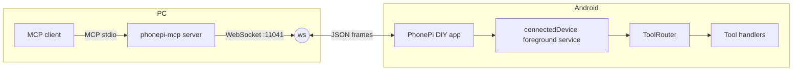
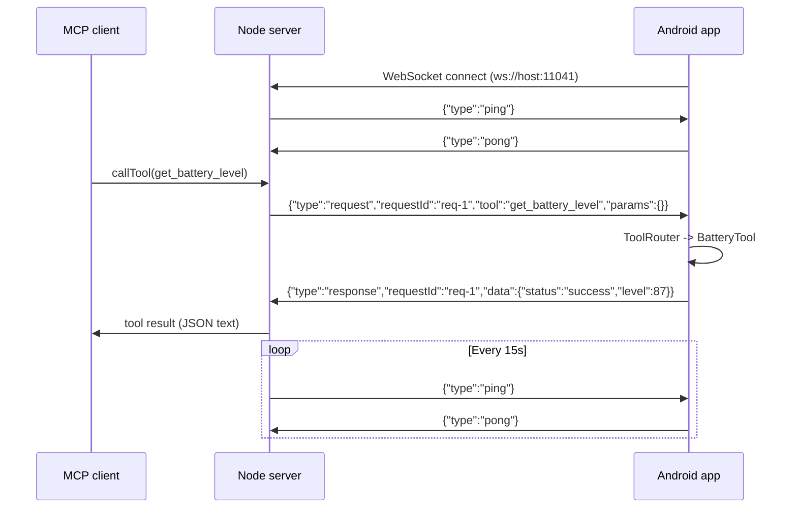

# System architecture

How the pieces fit and how a tool call travels from Cursor to the phone and back.

## Components

| Component | Runs on | Role |
|-----------|---------|------|
| MCP client (Cursor, Claude) | PC | Calls tools over MCP stdio |
| `phonepi-mcp` Node server | PC | Bridges MCP stdio to a WebSocket on port 11041 |
| PhonePi DIY app | Android | Connects out to the server; runs tools on the device |

The PC half already exists and stays unchanged for v1.

## Message flow

The phone connects to the server. The server sends tool requests. The phone answers.

Protocol detail lives in [`../research/01-protocol/websocket-spec.md`](../research/01-protocol/websocket-spec.md).

## Protocol contract the app must honor

| Rule | Value | Source |
|------|-------|--------|
| Connect URL | `ws://<host>:11041` | server binds port 11041 |
| First frame from server | `{"type":"ping"}` | sent on connect |
| Keepalive reply | `{"type":"pong"}` within 45s | server drops socket after 45s of no pong |
| Tool request shape | `{type, requestId, tool, params}` | server `CallTool` handler |
| Tool response shape | `{type:"response", requestId, data}` | server resolves on `data` |
| Response budget | 30 seconds per tool | server request timeout |
| Single connection | New socket replaces the old one | server keeps one phone slot |

## Platform constraints that shape the design

My follow-up research on current Android behavior surfaced two hard limits. Both drive specific design choices.

### Foreground service runtime cap

Android 15 (API 35) limits `dataSync` and `mediaProcessing` foreground services to **6 hours per 24-hour period** in the background. After the cap, the system calls `Service.onTimeout()`; ignoring it crashes the app.

A companion socket must stay connected far longer than 6 hours. So the socket runs under the **`connectedDevice`** foreground service type, which has no such cap. The app still implements `onTimeout()` as a safety net. See [03-connection-lifecycle.md](03-connection-lifecycle.md).

### Background activity launch limits

Android 14 (API 34) blocks a backgrounded app from calling `startActivity` unless it meets an exemption. `make_call` uses `Intent.ACTION_CALL`, which is an activity start. An AI-triggered call usually arrives while the app sits in the background.

So `make_call` does not call `startActivity` directly from the service. It posts a **full-screen-intent notification** whose `PendingIntent` opts into background activity start, or it brings the connection Activity forward first. See [05-permissions-foreground.md](05-permissions-foreground.md).

## Threading model

| Concern | Thread |
|---------|--------|
| WebSocket receive | OkHttp reader thread (`onMessage`) |
| Tool dispatch | Coroutine on `Dispatchers.Default` |
| ContentResolver (contacts, snippets) | `Dispatchers.IO` |
| Clipboard write, activity start | Main thread, with window focus |
| Send response | OkHttp `webSocket.send` (thread-safe) |

The receive callback never blocks. It hands work to a coroutine, then the handler sends the response when done, always within the 30-second budget.

## What the app does not do in v1

- No on-device MCP server.
- No outbound calls to the internet beyond the one server WebSocket.
- No cloud sync. All snippet and message state stays in local Room storage.
- No auth handshake (deferred to the hardening version).
