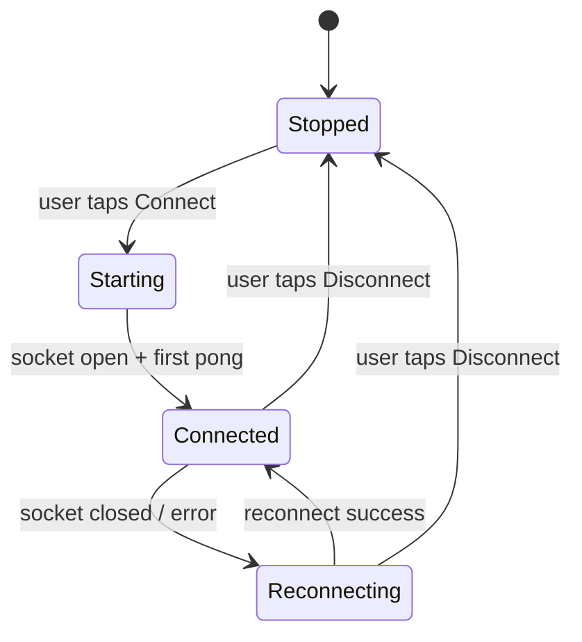

# Connection and lifecycle

The WebSocket manager, the foreground service that keeps it alive, keepalive handling, and reconnect.

## Why a foreground service

A bare background socket dies fast. Android kills background network on Android 8+ and tightens it further under Doze. To keep the link up, the socket lives in a foreground service with an ongoing notification.

## Foreground service type: `connectedDevice`

The choice of service type matters because of an Android 15 limit found in follow-up research.

| Type | Background runtime cap | Fit for a persistent socket |
|------|------------------------|------------------------------|
| `dataSync` | **6 hours per 24h**, then `onTimeout()` then crash if not stopped | Poor for an always-on link |
| `mediaProcessing` | Same 6-hour cap | Wrong use case |
| `connectedDevice` | No time cap | **Chosen** |

The companion link talks to a paired desktop and should stay connected all day. `connectedDevice` carries no 6-hour cap, so the service can hold the socket indefinitely.

### Cost of `connectedDevice`

To start a `connectedDevice` service, the app must hold at least one device-interaction permission. Confirmed on Android 16: `ACCESS_NETWORK_STATE` does **not** qualify. The qualifying normal permissions include `CHANGE_NETWORK_STATE`, `CHANGE_WIFI_STATE`, and `CHANGE_WIFI_MULTICAST_STATE`; the runtime ones include the Bluetooth and UWB permissions. Declare `CHANGE_NETWORK_STATE` (normal, no runtime prompt) since the app manages a network link.

```xml
<uses-permission android:name="android.permission.FOREGROUND_SERVICE" />
<uses-permission android:name="android.permission.FOREGROUND_SERVICE_CONNECTED_DEVICE" />
<uses-permission android:name="android.permission.CHANGE_NETWORK_STATE" />
<uses-permission android:name="android.permission.ACCESS_NETWORK_STATE" />

<service
    android:name=".connection.ConnectionService"
    android:foregroundServiceType="connectedDevice"
    android:exported="false" />
```

Pass the matching type to `startForeground`:

```kotlin
ServiceCompat.startForeground(
    this, NOTIF_ID, notification,
    ServiceInfo.FOREGROUND_SERVICE_TYPE_CONNECTED_DEVICE,
)
```

### Defensive `onTimeout`

Even with `connectedDevice`, implement `onTimeout()` so a future type change cannot crash the app.

```kotlin
override fun onTimeout(startId: Int) {
    // Should not fire for connectedDevice, but never crash if it does.
    webSocketManager.disconnect()
    stopSelf()
}
```

## Service lifecycle



- **Start** only from direct user action (tap Connect). Starting a foreground service from the background is restricted.
- **Persistent notification** on the `mcp_connection` channel shows status: Connected, Reconnecting, Disconnected. It carries a Disconnect action.
- **Stop** on user disconnect. Call `stopForeground` and close the socket.
- Use `START_STICKY` so the system can restart the service; reconnect logic takes over.

## WebSocketManager

Owns the OkHttp socket, the message loop, keepalive, and reconnect.

```kotlin
class WebSocketManager(
    private val scope: CoroutineScope,
    private val router: ToolRouter,
    private val onState: (ConnectionState) -> Unit,
) {
    private val client = OkHttpClient.Builder()
        .pingInterval(0, TimeUnit.SECONDS) // app answers app-level JSON ping; no OkHttp ping
        .readTimeout(0, TimeUnit.SECONDS)  // no read timeout on a long-lived socket
        .build()

    private var socket: WebSocket? = null
    private var attempt = 0

    fun connect(host: String, port: Int) {
        val request = Request.Builder().url("ws://$host:$port").build()
        socket = client.newWebSocket(request, listener)
    }

    private val listener = object : WebSocketListener() {
        override fun onOpen(ws: WebSocket, response: Response) {
            attempt = 0
            onState(ConnectionState.Connected)
        }
        override fun onMessage(ws: WebSocket, text: String) {
            when (val msg = WsMessage.parse(text)) {
                is WsMessage.Ping -> ws.send("""{"type":"pong"}""")
                is WsMessage.Request -> scope.launch {
                    val res = router.dispatch(msg.toToolRequest())
                    ws.send(res.toJson())
                }
                is WsMessage.Error -> log("server protocol error: ${msg.error}")
                else -> { /* ignore unknown types */ }
            }
        }
        override fun onClosed(ws: WebSocket, code: Int, reason: String) = scheduleReconnect()
        override fun onFailure(ws: WebSocket, t: Throwable, r: Response?) = scheduleReconnect()
    }
}
```

### Key points

- **Server drives keepalive.** It sends `{"type":"ping"}`; the app replies `{"type":"pong"}` at once. Disable OkHttp's own ping so the two do not fight. The app does not need its own timer.
- **No read timeout.** A long-lived socket should not trip an idle read timeout. The 45-second server keepalive detects a dead link.
- **`onMessage` never blocks.** It parses, then launches a coroutine for tool work, then sends the response. This protects the 30-second budget.

## Reconnect with backoff

The server does not queue requests while the phone is away, so reconnect fast but back off on repeated failure.

```kotlin
private fun scheduleReconnect() {
    onState(ConnectionState.Reconnecting)
    val delayMs = minOf(60_000L, 1_000L * (1 shl attempt.coerceAtMost(6)))
    attempt++
    scope.launch {
        delay(delayMs) // 1s, 2s, 4s ... cap 60s
        connect(currentHost, currentPort)
    }
}
```

Also watch `ConnectivityManager`. On network regain, reset `attempt` and reconnect at once instead of waiting out the backoff.

## Single-connection model

The server keeps one phone slot. A second connection closes the first. If the app gets kicked (for example a duplicate connect), it sees `onClosed` and reconnects. Avoid opening two sockets from one app instance.

## Battery optimization

OEM battery managers (Samsung, Xiaomi, others) kill background services aggressively. On first connect, prompt the user to exclude the app from battery optimization. Document this in the connect screen so a dropped link has an obvious fix.

## v1 connection path (localhost / adb)

For v1, prefer USB isolation:

1. Plug the phone into the PC.
2. Run `adb reverse tcp:11041 tcp:11041`.
3. Set the app host to `127.0.0.1`, port `11041`.
4. Start `phonepi-mcp` on the PC; tap Connect in the app.

Wi‑Fi LAN IP works too for convenience. Tailscale comes in the future version. See [06-security-roadmap.md](06-security-roadmap.md).
