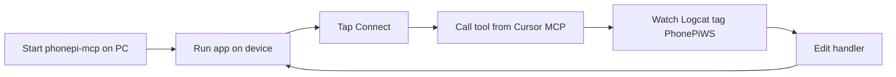

# Testing, build, and distribution

How to iterate fast on a real device, the Gradle and SDK setup, and how to install the app.

## Test device setup

SMS, calls, clipboard focus, and foreground-service behavior all differ on real hardware. Test on a physical phone.

| Item | Choice |
|------|--------|
| Device | Physical Android phone |
| Default link | Wi‑Fi / LAN (same network as the PC) |
| Isolated link | USB + `adb reverse` |
| Emulator | UI-only checks; no real SMS or calls |

### USB isolation path (recommended while building)

```powershell
adb devices
adb reverse tcp:11041 tcp:11041
```

Now the phone's `127.0.0.1:11041` forwards to the PC. Set the app host to `127.0.0.1`. No LAN exposure, and it works even on networks that block peer traffic.

### Wi‑Fi path

Find the PC's LAN IP, set the app host to it, and make sure the server binds an interface the phone can reach. The current server binds `0.0.0.0`, so the LAN IP works. Keep this to a trusted network until auth lands.

### Emulator path

For host loopback from an emulator, use `10.0.2.2:11041`. Good for Compose UI and protocol wiring; not for telephony.

## The iteration loop



| Task | Tool |
|------|------|
| Server | `phonepi-mcp start` on the PC |
| Logs | `adb logcat -s PhonePiWS:* ` |
| Fast UI edits | Android Studio Live Edit / Apply Changes |
| Trigger a tool | Call it from Cursor's MCP client |

### Test the protocol without Cursor

A small Node or `wscat` script can act as a fake server: accept the socket, send `{"type":"ping"}`, then send `{"type":"request",...}` frames and print responses. This lets you test handlers without the full MCP stack. Build this early; it speeds every later tool.

```bash
# example probe; adjust to your fake-server script
wscat -l 11041
> {"type":"request","requestId":"req-1","tool":"get_battery_level","params":{}}
```

## Unit and instrumented tests

| Layer | Test type | Approach |
|-------|-----------|----------|
| `ToolRouter` | JVM unit | Feed a `ToolRequest`, assert the `ToolResponse` |
| Each handler | JVM unit (Robolectric) | Mock the system service, assert the `data` payload |
| WebSocket flow | Instrumented | Run against the fake server; assert ping/pong and a round-trip |
| Permissions | Instrumented | Grant/deny via test APIs; assert error payloads |

The handler interface keeps tests simple: in a `JsonObject`, out a `JsonObject`. No socket needed for handler tests.

## Gradle and SDK setup

| Setting | Value | Reason |
|---------|-------|--------|
| Language | Kotlin | Native device access |
| `minSdk` | 26 | Covers clipboard and channel rules; wide device reach |
| `compileSdk` / `targetSdk` | Latest stable (35+) | Build against current behavior; the `connectedDevice` FGS choice already handles the Android 15 cap |
| Build system | Gradle Kotlin DSL | Type-safe build files |

Targeting the latest SDK is the right call because the design already accounts for the Android 15 foreground-service cap and Android 14 background-launch rules. Targeting an old SDK to dodge them would only delay the work and ship a fragile app.

### Core dependencies

```kotlin
dependencies {
    implementation("com.squareup.okhttp3:okhttp:<latest>")
    implementation("org.jetbrains.kotlinx:kotlinx-serialization-json:<latest>")
    implementation("org.jetbrains.kotlinx:kotlinx-coroutines-android:<latest>")
    implementation("androidx.room:room-runtime:<latest>")
    ksp("androidx.room:room-compiler:<latest>")
    implementation("androidx.datastore:datastore-preferences:<latest>")
    implementation(platform("androidx.compose:compose-bom:<latest>"))
    implementation("androidx.compose.material3:material3")
    // get_location (M5)
    implementation("com.google.android.gms:play-services-location:<latest>")
    // take_photo (M5)
    implementation("androidx.camera:camera-camera2:<latest>")
}
```

Pin real versions when you scaffold the project; do not invent version numbers.

## Build and install (sideload)

```powershell
# Debug build for iteration
./gradlew assembleDebug
adb install -r app/build/outputs/apk/debug/app-debug.apk

# Signed release for daily use
./gradlew assembleRelease
adb install -r app/build/outputs/apk/release/app-release.apk
```

### Signing

Generate one keystore and reuse it so updates install over the prior version.

```powershell
keytool -genkey -v -keystore phonepi.keystore -alias phonepi -keyalg RSA -keysize 2048 -validity 10000
```

Store the keystore outside the repo. Reference it from `build.gradle.kts` through a local properties file, never committed.

### Install notes

- Enable "Install unknown apps" for your installer on the phone.
- Play Protect may warn on an app that declares `SEND_SMS` from a sideload. Accept the warning for your own build.
- No Play Store means no auto-update. Reinstall the signed APK to update.

## Definition of done per milestone

A milestone is done when:

1. Each tool returns the expected `data` shape, checked against a live MCP call.
2. Errors return `{ "status": "error", "error": ... }`, never a socket drop.
3. The connection survives screen-off and an app background for at least an hour on the test device.
4. Reconnect works after killing and restarting the server.
