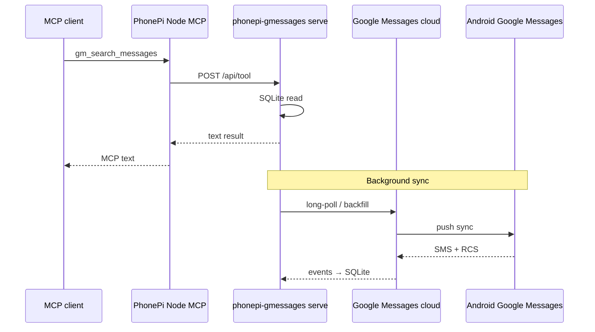

# Google Messages web pairing (SMS + RCS)

PhonePi reads carrier SMS through the Android app (`get_sms_messages`). **RCS and many Google Messages chats never appear in `Telephony.Sms`**, which is why contact-based SMS queries can return zero messages even when the chat is visible in Google Messages.

This document describes the **Google Messages bridge**: a desktop pairing path adapted from [openmessage](https://github.com/FreesoSaiFared/openmessage), vendored under `vendor/openmessage`.

## Problem statement

| Source | SMS | RCS | Requires phone WebSocket |
|--------|-----|-----|------------------------|
| Android `get_sms_messages` | Yes | No | Yes |
| Google Messages bridge (`gm_*` tools) | Yes | Yes | No (after pairing) |

Both can coexist. Use phone tools for device actions; use `gm_*` tools for **full message history** including RCS.

## Architecture decision

**Chosen: Option A — Go sidecar (vendored openmessage) + Node HTTP bridge**

| Option | Verdict |
|--------|---------|
| A. Go sidecar + HTTP `/api/tool` | **Selected** — full openmessage feature set, minimal reinvention |
| B. Port libgm to TypeScript | Rejected — protocol is large, high risk |
| C. Separate MCP server only | Rejected — user wants one PhonePi MCP with all tools |

### Data flow



### Components

| Path | Role |
|------|------|
| `vendor/openmessage/` | Upstream openmessage source (libgm, SQLite, MCP tools, web UI) |
| `messages-bridge/` | PhonePi wrapper binary `phonepi-gmessages.exe` |
| `server/src/gmessages/` | Node client calling `POST /api/tool` |
| `server/src/gmessages/sidecar.ts` | Auto-start `phonepi-gmessages serve` when paired |
| `server/src/index.ts` | Registers `gm_*` MCP tools; routes away from phone WebSocket |

### Local storage

| File | Purpose |
|------|---------|
| `%USERPROFILE%\.local\share\phonepi-gmessages\session.json` | Pairing session (treat as secret) |
| `%USERPROFILE%\.local\share\phonepi-gmessages\messages.db` | SQLite cache (SMS + RCS) |

Override with `PHONEPI_GMESSAGES_DATA_DIR`.

### Network ports

| Port | Service |
|------|---------|
| 11041 | PhonePi Android WebSocket (unchanged) |
| 11042 | Google Messages bridge HTTP (default) |

Set `PHONEPI_GMESSAGES_URL=http://127.0.0.1:11042` on the Node MCP process if needed.

## openmessage feature mapping

| openmessage tool | PhonePi MCP name | Notes |
|------------------|------------------|-------|
| `get_messages` | `gm_get_messages` | Filters: phone, after, before, limit |
| `get_conversation` | `gm_get_conversation` | Full thread by conversation ID |
| `search_messages` | `gm_search_messages` | FTS across all messages |
| `send_message` | `gm_send_message` | SMS/RCS send via Google |
| `list_conversations` | `gm_list_conversations` | |
| `list_contacts` | `gm_list_contacts` | |
| `get_status` | `gm_get_status` | |
| `draft_message` | `gm_draft_message` | |
| `download_media` | `gm_download_media` | |
| `react_to_message` | `gm_react_to_message` | **PhonePi addition** (web UI had `/api/react`, now MCP too) |

PhonePi prefixes tools with `gm_` to avoid clashing with `send_message` (interactive phone notification).

### PhonePi patches to vendored openmessage

1. `internal/tools/execute.go` — HTTP tool dispatcher
2. `internal/web/tool_bridge.go` — `POST /api/tool`, `GET /api/tools`
3. `internal/tools/react_to_message.go` — MCP reaction tool
4. `internal/app/app.go` — default data dir `phonepi-gmessages`
5. `cmd/serve.go` — default port `11042`, wire `APIHandlerFullWithApp`

## Pairing UX

```powershell
cd messages-bridge
.\build.ps1
.\phonepi-gmessages.exe pair
```

QR displays in terminal. On phone: **Google Messages → Settings → Device pairing → Pair a device**.

Then:

```powershell
.\phonepi-gmessages.exe serve
```

Or rely on **auto-start**: when the PhonePi Node MCP server boots and `session.json` exists, it spawns `phonepi-gmessages serve` if port 11042 is free (see `server/src/gmessages/sidecar.ts`). The sidecar stays running after MCP exits.

- Web UI: http://localhost:11042
- Backfill runs on startup (full history sync)
- Real-time events update SQLite via libgm long-poll

## Security

- **Local only** — bridge binds localhost; no cloud relay except Google’s own Messages protocol
- **Session file** — equivalent to “Messages for Web” access; protect `session.json`
- **Untrusted content** — openmessage prepends a prompt-injection warning on message reads; preserved in tool output
- **No Android permission changes** — pairing does not use `READ_SMS` on the companion app

## Mom / RCS test plan

1. Build and pair (above)
2. Run `serve`; wait for backfill (watch logs)
3. In Cursor, call `gm_list_conversations` — find Mom
4. Call `gm_get_conversation` with her `conversation_id`
5. Or `gm_search_messages` with text you know she sent
6. Compare: `get_sms_messages` on phone may still be empty for RCS; `gm_*` should show the thread

## v2 gaps

- [x] Auto-start `phonepi-gmessages serve` from Node MCP on boot (when paired; skip if port busy; leave sidecar running on MCP exit)
- [x] Embed GM web UI link in PhonePi test console
- [ ] `gm_send_message` via conversation_id + reply_to (web API supports; MCP tool uses phone_number only)
- [ ] Push new messages to MCP as resources/notifications (today: pull-only tools)
- [ ] Media inline in MCP responses (today: `gm_download_media` saves to temp file path)
- [ ] Update vendored openmessage on a schedule (upstream churn)

## Build (Windows)

```powershell
# Go bridge
cd messages-bridge
.\build.ps1

# Node MCP
cd ..\server
npm run build
```

## References

- [openmessage README](../vendor/openmessage/README.md)
- [mautrix-gmessages / libgm](https://github.com/mautrix/gmessages)
- [Android RCS archival (enterprise only)](https://developer.android.com/work/dpc/rcs-messages-archival)
