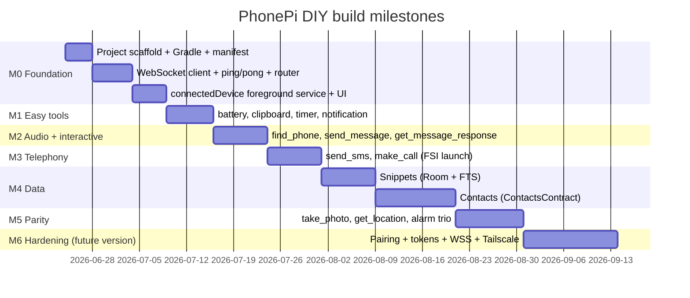

# PhonePi DIY Android app: design documentation

This folder holds the design for an open-source Android companion app that replaces the paid, closed-source PhonePi app. The app connects to your existing `phonepi-mcp` Node server and runs all phone-side tools.

These docs build on the research in [`../research/`](../research/README.md). Read that first for protocol and tool detail.

## Goal

Build a Kotlin Android app you own. It must do everything the server documents, run locally, test easily on a real device, and grow into a secure Tailscale setup later.

## Locked decisions

| Decision | Choice | Why |
|----------|--------|-----|
| Platform | Kotlin native (Android SDK) | Direct access to SMS, calls, contacts, alarms; reliable background socket |
| App role | WebSocket client to the existing Node server | No server rewrite; matches the real protocol |
| Scope (v1) | Full parity: 22 active tools + 5 disabled tools (27 total) | You want every documented feature |
| Server | Keep untouched for v1; harden in a later phase | Get a working prototype fast |
| Security (v1) | Localhost / `adb reverse` only | Smallest exposure while building |
| Security (future) | Tailscale-only remote + token auth + WSS | Planned later version |
| Testing | Physical device over Wi‑Fi / LAN | SMS and calls do not work on emulators |
| Distribution | Personal sideload (APK) | Avoids Play Store SMS/CALL policy limits |
| Package | `dev.phonepi.companion` | App ID |
| SDK | `targetSdk = 36`, `minSdk = 26` | Device runs Android 16 |
| `make_call` | Full-screen-intent confirm | Background-safe, human in the loop |
| SMS/call safety | Phone-side confirmation in v1 | Prompt-injection guard |

See [00-decisions.md](00-decisions.md) for the full decision log.

## Document map

| Doc | Topic |
|-----|-------|
| [00-decisions.md](00-decisions.md) | Decision log with rationale and open questions |
| [01-system-architecture.md](01-system-architecture.md) | End-to-end architecture, message flow, platform constraints |
| [02-android-app-design.md](02-android-app-design.md) | Modules, layers, `ToolRouter`, threading, data layer |
| [03-connection-lifecycle.md](03-connection-lifecycle.md) | WebSocket manager, foreground service type, reconnect, keepalive |
| [04-tool-handlers.md](04-tool-handlers.md) | Handler contract, response envelope, all 27 tools |
| [05-permissions-foreground.md](05-permissions-foreground.md) | Permission tiers, FGS types, background call launch |
| [06-security-roadmap.md](06-security-roadmap.md) | v1 local, future pairing / WSS / Tailscale phases |
| [07-testing-build-distribution.md](07-testing-build-distribution.md) | Device testing, Gradle, target SDK, sideload, signing |

## Core principles

1. **Server stays the trust boundary.** The phone connects out; it never hosts an open endpoint.
2. **One handler per tool.** A registry maps a tool name to one Kotlin function.
3. **Consistent envelope.** Every response uses `{ "status": "success" | "error", ... }`.
4. **Fail soft.** Tool errors return an error payload; they never crash the socket.
5. **Permission tiers.** Request dangerous permissions only when you enable that tool group.
6. **Design for current Android.** Plan around the Android 15 foreground-service cap and Android 14 background-launch rules from day one.

## Two platform constraints that shape everything

These come from my follow-up research on current Android behavior. Both change the connection and call design.

### 1. Foreground service time cap (Android 15, API 35)

The system limits `dataSync` foreground services to **6 hours per 24-hour period** while the app is in the background. After that, it calls `onTimeout()` and you must stop the service or the app crashes. A persistent companion socket cannot live under `dataSync` long-term.

**Design response:** use the **`connectedDevice`** foreground service type for the socket (no 6-hour cap), and still implement `onTimeout()` defensively. Detail in [03-connection-lifecycle.md](03-connection-lifecycle.md).

### 2. Background activity launch limits (Android 14, API 34)

A backgrounded service cannot call `startActivity` freely. `make_call` uses `Intent.ACTION_CALL`, which starts an activity. From the background this gets blocked.

**Design response:** trigger calls through a **full-screen-intent notification** with background-activity-start opt-in, or bring the app forward first. Detail in [05-permissions-foreground.md](05-permissions-foreground.md).

## Milestone roadmap

Milestone detail and the v1 tool list live in [04-tool-handlers.md](04-tool-handlers.md).
