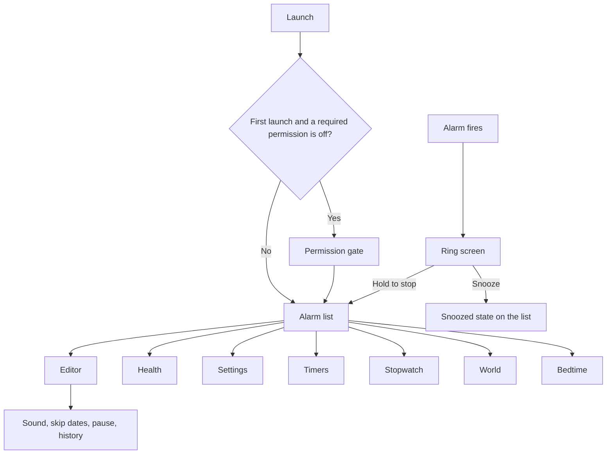

# PhonePi Clock UI

Design for a separate Android app that replaces Google Clock on Alex's Pixel 9 Pro XL. This document is the UI spec. It does not add app code.

The app rings on its own. Bots can list, create, edit, skip, and delete alarms. The screen has to show both facts at a glance, including when Alex is half awake and using one hand.

Build it in Jetpack Compose with Material 3 Expressive, on Android 16. The phone canvas is the Pixel 9 Pro XL: 6.8 in, 1344×2992, 486 ppi ([Google Store specs](https://store.google.com/us/product/pixel_9_pro_specs?hl=en-US)). Lay out at 448×997 dp, which is that pixel grid at 3 px per dp. Confirm `densityDpi` on the device and keep these dp sizes if the bucket differs. Body size is 162.8×76.6×8.5 mm ([GSMArena](https://www.gsmarena.com/google_pixel_9_pro_xl-13217.php)). Primary controls sit in the bottom half of that tall screen.

Wireframes, dark theme, same 448 dp width:

- [Alarm list](mockups/alarm-list.svg)
- [Alarm edit](mockups/alarm-edit.svg)
- [Ringing screen](mockups/ringing.svg)
- [Timers](mockups/timers.svg)
- [Bedtime](mockups/bedtime.svg)

## Decisions

1. The next alarm is the header on every screen except the ring screen. "On" is secondary.
2. A repeating ladder is one card. Saturday 7:45, 7:55, 8:05, and 8:15 is one group, not four peers.
3. Every bot create or edit shows a chip, "Set by Morning bot" or "Changed by Morning bot", and a history sheet.
4. Add, Save, Snooze, and Stop are bottom controls. There is no corner FAB.
5. An armed alarm gets a 4 dp bar, not a bright full-card fill. Night use stays dim.
6. The ring screen is a fixed near-black color. It ignores wallpaper, the app theme, and dynamic color. Screen brightness on that activity is capped.
7. The control on the chin is Snooze. Stop sits above it and takes an 800 ms hold, or an upward swipe.
8. Volume down snoozes. Volume up does nothing. A pocket press must not kill the alarm.
9. Close alarms all ring. The earlier one is never dropped because another is near.
10. Dark is the stored default. Light and System are in settings. Dynamic color paints chrome only. Armed, warning, missed, and bot colors stay fixed.
11. Time entry opens on a keypad. The dial is a second mode. Day chips read Mon, Tue, Wed, not single letters.
12. Swipe never deletes an alarm, and swiping a notification never skips one.

## Who it's for

Alex sets and checks alarms one-handed, often without looking long. He also lets bots change them. The UI has two jobs:

- Show that the next ring is real, soon, and armed.
- Show who last touched it, in one line, without opening a log.

Half-awake use is a third job, and it only happens on the ring screen. That screen has two actions, huge type, and a safe mistake (snooze).

## What Google Clock does well

These are worth keeping in spirit.

- Times are the loudest thing on the screen. Clock 8.1 (August 2025) also fills the card of an alarm that is on, so state is not only a switch and a bold font ([9to5Google, 22 Aug 2025](https://9to5google.com/2025/08/22/google-clock-material-3-expressive/)).
- Edit moved into a sheet, and related settings sit in containers. Stopwatch got large labeled buttons. The bottom bar got shorter. Widgets did not change in that release.
- Bedtime still puts sleep and wake on one schedule and shows how long you'll be in bed. The wake alarm also appears in the alarm list ([Clock Help, bedtime](https://support.google.com/clock/answer/9887159)).
- You can pause a repeating alarm for a date range, snooze, ramp the volume, set silence-after, and pick what the volume keys do ([Clock Help, alarms](https://support.google.com/clock/answer/2840926)).
- The system Alarm quick-settings tile shows the next alarm, and a tap opens Clock ([9to5Google, 19 May 2021](https://9to5google.com/2021/05/19/android-12-alarm-quick-settings-tile/)).
- Clock 8.3 put the ringing screen back on a solid color. The 8.1 wallpaper treatment made the time unreadable ([Android Central, 28 Oct 2025](https://www.androidcentral.com/apps-software/google-clock-update-ditches-wallpaper-chaos-for-a-cleaner-alarm-screen), [9to5Google, 13 Nov 2025](https://9to5google.com/2025/11/13/google-clock-8-3/)).
- Clock 9.1 (September 2026) added 1, 5, 10, and 15 minute timer presets, a Start pill, and a grid for several timers ([9to5Google, 3 Sep 2026](https://9to5google.com/2026/09/03/google-clock-timers-redesign/)).

## Where Google Clock is the wrong model

- Highlighting every on-alarm answers "what is enabled?". Alex needs "what rings next?". Four Saturday cards, all bright, still don't read as one routine.
- Help tells you to leave a 5 minute gap, because two close alarms can cancel the first ([Clock Help, alarms](https://support.google.com/clock/answer/2840926)). A 10 minute ladder is the product, not an error.
- There is no durable "who set this". Assistant and Gemini can land alarms in Google Clock while it stays enabled. PhonePi has to show the actor.
- Pause, snooze length, ramp, and silence-after are easy to lose in overflow and global settings. Per-alarm values should be on the editor.
- Stop became a large tap, which people hit from a pocket. Swipe used to add friction. Google later added a choice, "Dismiss alarms with", behind a server-side rollout ([Android Police](https://www.androidpolice.com/google-clock-makes-it-harder-accidentally-dismiss-alarms/), [9to5Google, 23 Jan 2023](https://9to5google.com/2023/01/23/google-clock-7-4-alarm-timer/)). PhonePi splits the risk: snooze is the easy tap, stop is a hold.
- The 8.1 alarm screen followed the wallpaper, then 8.3 reverted it. PhonePi never uses the wallpaper behind a time you must read.
- A corner square FAB is the 8.1 add button. On a 163 mm phone that is the far corner from a one-handed grip.
- Single-letter day markers are ambiguous, because the week has two T's and two S's. PhonePi chips read Mon, Tue, Wed.
- Timer presets in 9.1 start on tap, and several timers collapse into a grid. A pocket tap should not start a timer. A grid makes each target smaller.
- Bedtime did not get the expressive pass, and grayscale bedtime mode depends on Digital Wellbeing. PhonePi's bedtime can turn on Do Not Disturb only if Alex opts in. It does not offer grayscale.
- The stock Alarm tile shows the next alarm and opens the app. It does not show a bot edit, a skip, or a running timer that ends sooner.

## Principles

- **Trust.** The armed strip names the next ring, the countdown, and whether it is armed. If it is not armed, the strip says so in the same place.
- **Bedroom.** Dark by default. Large surfaces stay under a low tone. No pure white fills. The ring screen caps brightness.
- **One hand.** 48 dp minimum. Primary actions are at least 64 dp tall and live in the bottom half. No top-right-only primary action.
- **Glance.** One idea per card: time, when, who. Details go to the editor.
- **Provenance.** Bot and migration edits are visible on the card. History is one tap away.
- **Safe mistake.** The easy gesture snoozes or skips. Delete, stop, and ungroup take a confirm or a hold.
- **Plain words.** The health screen says what broke and which button fixes it.
- **Material 3 Expressive.** `MaterialExpressiveTheme`, dynamic color for chrome, expressive motion, fully rounded buttons. The layout is not Google Clock's.

PhonePi Companion today is a small Compose app on default Material colors, with plain rows for status and recent activity. Clock should feel like the same family: direct copy, switches, a simple activity list. It is darker, because it lives on the nightstand.

## Information architecture

```text
PhonePi Clock
├── Permission gate (first launch, only if something required is missing)
├── Alarms                         P1  start destination
│   ├── Armed strip                all phases, hidden on the ring screen
│   ├── Group card (ladder)
│   ├── Single alarm card
│   ├── Editor
│   │   ├── Keypad (default) / Dial
│   │   ├── Day chips
│   │   ├── Ladder (+10 min rung)
│   │   ├── Sound sheet
│   │   ├── Vibration, ramp, snooze, silence-after
│   │   ├── Skip dates sheet
│   │   ├── Pause sheet
│   │   └── History sheet
│   ├── Group actions sheet
│   ├── Delete confirm
│   └── Migration sheet            P1, one time
├── Timers                         P2
│   ├── Keypad + presets
│   ├── Running list
│   └── Timer ring
├── Stopwatch                      P2
├── World                          P3
│   └── City search
├── Bedtime                        P3
│   ├── Schedule arc
│   ├── Wake alarm (a normal alarm)
│   ├── Reminder
│   ├── Do Not Disturb opt-in
│   └── Sleep sounds + sleep timer
├── Health                         P1
├── Settings                       P1, short
├── Notifications                  see below
├── Quick settings tile            P3
├── Widgets                        P3
├── Sunrise                        P4, wake alarm only
└── Weather after stop             P4, only if a source exists
```

P1 ships Alarms, the ring screen, notifications for that loop, health, and settings. The bar has one destination, so it is hidden. P2 adds Timers and Stopwatch. P3 adds World, Bedtime, the tile, and widgets. P4 adds sunrise and the weather card. Do not show a dead tab for a later phase.



Back from a sheet or the editor closes it. Back from a tab root does not switch tabs. Back on the ring screen snoozes.

## Canvas and chrome

| Item | Spec |
| --- | --- |
| Layout width | 448 dp. Horizontal margin 20 dp. Usable width 408 dp. |
| Gaps | 8 dp inside a row, 12 dp between rows, 16 dp between cards. |
| Bottom inset | Navigation bar plus the gesture inset. Scroll content clears both. |
| Edge to edge | Yes. Scrim the status bar with the background color. Draw nothing under the camera cutout. |
| Top bar on the list | None. The armed strip is the header. The selected nav label already says Alarms. |
| Top bar on editor, health, settings | Back at the start, title, one optional text action at the end ("History"). Back is 48 dp. |
| Add control | Full-width button, 64 dp, 20 dp above the nav bar. Label "New alarm". |
| Nav bar | M3 `NavigationBar`, about 80 dp. Labels always visible. Shown from P2. |
| Tab swipe | Off. A sideways swipe must not change sections. |
| Scroll | The list scrolls under the armed strip. The strip sticks. |
| Pull to refresh | None. The phone is the source of truth. |
| Theme default | Dark, stored, until Alex picks Light or System. |
| Launcher name | PhonePi Clock. "Clock" alone is too easy to confuse with Google Clock during the overlap. |

Nav labels and TalkBack names:

| Phase | Visible label | TalkBack |
| --- | --- | --- |
| P1 | Alarms only, bar hidden | Alarms |
| P2+ | Alarms, Timers, Watch | Stopwatch on the Watch item |
| P3+ | Alarms, Timers, Watch, World, Bed | World clock, Bedtime |

Five labels fit a 448 dp bar. "Stopwatch" and "Bedtime" as visible words collide with the icon at large font scale, so the short labels are the visible ones and the semantics stay long.

## Armed strip

Shown on Alarms, Timers, Stopwatch, World, Bedtime, Health, and Settings. Hidden on the ring screen, the permission gate, and modal sheets.

The strip is one rounded container, 72 dp minimum, shape `extraLarge` (28 dp). A 4 dp bar on the leading edge carries the status color. The rest of the fill is `surfaceContainer`, in both themes. Do not paint the whole strip in the status color.

Two tap targets:

- The row opens the next alarm, timer, or bedtime wake alarm, whichever the strip is counting.
- The status pip is a separate 48 dp target. It opens Health.

| State | Bar | Line 1 | Line 2 | Example |
| --- | --- | --- | --- | --- |
| Armed | Armed | Next · Sat 7:45 AM | in 7 h 12 min · Armed | Normal Saturday |
| Snoozed is soonest | Snoozed | Snoozed · 7:55 AM | rings in 8 min · 1 of 3 | After a snooze |
| Pre-alarm | Armed | Next · Sat 7:45 AM | in 22 min · Armed | Inside the upcoming window |
| Skipped, later ring exists | Armed | Next · Sat 7:55 AM | 7:45 skipped this Saturday | Group skip of one rung, or the next rung |
| Nothing enabled | Neutral | No alarm set | Alarms on this phone are off | All switches off |
| Missed, still unresolved | Missed | Missed · Sat 7:45 AM | Phone was off · Got it | Until Alex clears it |
| Exact alarms off | Warning | Not armed | 7:45 AM may ring late | List still visible |
| Notifications off | Warning | Next · Sat 7:45 AM | Screen may not turn on | Second line replaces the countdown's trailing word |
| Offline | Armed, if local alarm is armed | Next · Sat 7:45 AM | in 7 h 12 min · Bots last saw 6:12 PM | Local ring is unchanged |
| Google Clock collision | Warning | Next · Sat 7:45 AM | Google Clock also has 7:45 AM | Tap row still opens the PhonePi alarm. Pip opens Health. |

Countdown text updates once a minute until the last hour, then once a second inside the last minute. Use tabular figures so the strip does not jitter.

TalkBack on the row: "Next alarm, Saturday 7:45 AM, in 7 hours 12 minutes, armed. Opens alarm." Pip: "Clock health, armed. Opens health."

## Alarm list

Start destination. Vertical list. Order:

1. Armed strip.
2. Banners, if any, in this order: exact alarm, notifications, full-screen intent, battery, Do Not Disturb blocking alarms, Google Clock collision, offline.
3. The group or alarm that rings next, expanded.
4. Other enabled groups and alarms, by next ring time, collapsed if they are groups.
5. Paused, then skipped-with-nothing-sooner, then off alarms.
6. Unresolved missed alarms stay in position 3 until cleared, above the next future ring.

A lone alarm is a card. Two or more alarms that share a `groupId` are one card. See [Data the UI needs](#data-the-ui-needs).

### Group card

Container `surfaceContainer`, shape `extraLarge`, padding 16 dp. The next group also has the 4 dp armed bar.

| Row | Content |
| --- | --- |
| Title | Group label, `titleLarge`. Trailing switch, 48 dp target. |
| Provenance | Chip, only when the last actor is not Alex. |
| Schedule | "Sat" or "Mon, Tue, Wed, Thu, Fri" or "Once". |
| Ladder | One row per rung. Leading 2 dp line ties the rows. Time at `clockRung`. Optional rung label. |
| Meta | "Rings in 7 h 12 min" on the next rung's row, not repeated on the others. |
| Actions | "Skip this Saturday" as a tonal button, full width of the card, 48 dp. |

Collapsed group, used for groups that are not next: label, "7:45 to 8:15 · 4 alarms", provenance chip, switch, and the skip button. Tap the body to expand. The switch and skip stay visible while collapsed.

Rung row tap opens the editor focused on that time. Switch turns every rung on or off. If some rungs are off and some are on, the switch shows the mixed state. Tap then turns all on.

Skip writes today's upcoming local date, or the next date that group would ring, onto each enabled rung. The button label becomes "Skipped Sat" and a snackbar says "Skipped Saturday morning" with Undo for 8 seconds. Undo removes that date.

Overflow on the card, a 48 dp icon button at the end of the title row, opens the group actions sheet:

| Action | Result |
| --- | --- |
| Shift all 10 min earlier | Every rung moves back 10 minutes. Undo snackbar. |
| Shift all 10 min later | Every rung moves forward 10 minutes. Undo snackbar. |
| Pause dates | Pause sheet. |
| Make separate alarms | Clears `groupId`. Confirm: "Split Saturday morning into 4 alarms?" |
| Delete group | Confirm: "Delete Saturday morning, all 4 alarms?" |

Long-press is not required for any of these.

### Single alarm card

Same container. Time at `clockList` (36 sp). Second line: label, then days, then the provenance chip if needed. Trailing switch. Bottom action: "Skip next" if it repeats, or nothing if it is one-time (turning it off is the switch).

Tap the body to edit. Swipe left reveals "Skip next" with an Undo snackbar, same result as the button. Swipe right does nothing. There is no swipe-to-delete.

Off card: time and label use `onSurfaceVariant`. No armed bar. Switch off. Hide skip.

### List states

| State | What you see |
| --- | --- |
| Empty, permissions ok | No illustration. Title "No alarm yet." Body "The next one shows here, with who set it." Buttons: "New alarm", "Saturday ladder". |
| Saturday ladder template | Creates four rungs at 7:45, 7:55, 8:05, 8:15, repeat Saturday, label "Saturday morning", sound default, vibrate on, ramp 30 s, snooze 10 min, max 3, silence after 10 min, `createdBy` app. Alex can edit before the first night. |
| First launch, permission missing | Permission gate, then this empty state. |
| Scheduled, on | Card as above. Next one expanded with the armed bar. |
| Scheduled, off | Muted card, switch off, still in the list. |
| Pre-alarm | Skip button uses the primary fill so it is the obvious action. Strip second line uses minutes. |
| Ringing | The ring activity covers the app. The list is not the UI for a firing alarm. |
| Snoozed | Card line "Snoozed until 7:55 AM · 1 of 3". Button "Cancel snooze". Strip follows the snooze if it is soonest. |
| Skipped | Time stays. A chip "Skipped Sat". Switch stays on. Button becomes "Undo skip" until that instant passes. |
| Missed | Chip "Missed". Body "Phone was off" or "It stopped on its own". Button "Got it". Repeating alarms stay on. A one-time alarm stays off after Got it. |
| Paused | Chip "Paused until Jan 1". Switch stays on. Button "Resume". |
| One-time, waiting | Days line "Once · Sat 7:45 AM". After dismiss it turns off and drops under the off group, or leaves the list if `deleteAfterRing` is set. |
| Permission missing | Banners above the cards. Alarms stay visible. Strip matches the table above. |
| Offline | Banner "This phone is offline. Bots last saw your alarms at 6:12 PM. Alarms here still ring." Cards stay editable. |
| Bot edit while open | Chip updates. Card background flashes `primaryContainer` for 200 ms. One snackbar: "Morning bot changed Saturday morning". Action "View", opens history. Do not stack one snackbar per rung. |
| Collision | Banner "Google Clock also has an alarm at 7:45 AM. This one still rings. Turn the Google Clock alarm off if you don't want both." Actions: "Open Google Clock", "Hide". Hide remembers that pair of instants, not the warning feature. |
| DST, spring | On the affected card, for that week: "Rings at 3:00 AM. 2:30 AM doesn't exist this day." |
| DST, fall | "Rings once, at the first 1:30 AM." |
| Mixed rungs | Group switch in the mixed state. Off rungs use `onSurfaceVariant` and drop out of the skip set. |
| Two rungs, same minute | Editor blocks save. List never shows that state. |

Migration, once, after the four Saturday alarms exist here and Google Clock still has a near duplicate: a sheet, not a blocking page.

Title: "Turn these off in Google Clock." Body: "PhonePi can't switch them off for you. Leave them off, not deleted, if you want a fallback." List the four times. Button "Open Google Clock". Secondary "I'll do this later". The collision banner remains until the self-test stops seeing the pair, or Alex hides it.

## Alarm editor

Full screen, not a sheet. A sheet fits two toggles. A ladder, a sound, and a history do not.

Sticky footer: "Save", 64 dp, full width inside the 20 dp margin. Disabled until the draft is valid and dirty. New alarms enable Save once a time is set.

Top bar: Back, "Edit alarm" or "New alarm", trailing "History" (hidden on a new alarm that has no events).

Back with a dirty draft: "Discard changes?" Confirm and Discard. Save stays the footer, so the dialog does not need a third button.

### Time

Hero readout, `clockList`, tabular, updates as digits land. Beside it, an AM/PM segmented control, 64 dp tall, hidden in 24-hour mode. Follow the system 12/24 setting. Do not add an in-app override.

Segmented control under the hero: "Keypad" and "Dial". Keypad is the default for every alarm, stored per process, not per alarm.

Keypad:

- Fills four digits, left to right, as hour and minute. "745" becomes 7:45. "0745" becomes 7:45. A fifth digit replaces from the start.
- Keys 1 to 9, then a row with empty, 0, backspace. Shape `large` (16 dp), not a circle and not a bare glyph. Fill `surfaceContainerHigh`.
- Key size: three columns, 12 dp gutters, 20 dp screen margin. About 128×72 dp. The target is the whole key.
- Backspace removes one digit.
- 12-hour hours are 1 to 12. A digit that cannot fit shows "Hour is 1 to 12" under the hero and triggers a reject haptic. 24-hour hours are 0–23, same pattern.
- No text field. Alex should not have to type.

Dial:

- Standard Material time dial, vertical layout, 280 dp. Dragging updates the hero.
- AM/PM and Save stay at the bottom. Do not add a second OK.

### Days

`FlowRow` of filter chips: Mon Tue Wed Thu Fri Sat Sun. Minimum 48 dp height, 12 dp horizontal padding, `labelLarge`. They wrap. They do not shrink into single letters.

TalkBack: "Saturday, selected." Selected fill is `primaryContainer`.

None selected means one-time, on the next occurrence of that time. Helper line: "Once. It turns off after it rings." One or more selected: "Repeats Sat."

Week start defaults to Monday. Settings can switch it to Sunday. The chip order follows that.

### Ladder

Section title "Ladder". Each rung is a row: time button (opens the keypad for that rung), optional short label, remove icon if there are two or more.

Button "Add 10 min". It copies the last rung and adds 10 minutes, wrapping past midnight into the next day and saying so: "8:15 PM plus 10 min is 8:25 PM." If the add crosses midnight, the helper says "This rung is after midnight."

Cap 8 rungs. The ninth asks "That's 8 alarms. Add another?" so a stuck button cannot mint dozens.

Same minute as another rung: inline "Two rungs at 7:45. Move one." Save stays disabled.

A gap under 10 minutes, including a custom edit: helper, not an error. "These are close. Each one still rings. If you haven't stopped the first, it is still going when the next starts."

Removing the second-to-last rung turns the card back into a single alarm and clears `groupId`.

Shared across rungs: label, days, sound, vibrate, ramp, snooze, max snoozes, silence-after, skip dates, pause range. Per rung: time, optional rung label, enabled.

Group label is an outlined text field, "Name", default "Saturday morning" for the template and empty for a blank alarm. Empty label is allowed. The card then shows the time as the title.

### Sound, vibration, ramp, snooze, silence

`ListItem` rows, 64 dp minimum, trailing value, tap opens the control.

| Row | Default | Control |
| --- | --- | --- |
| Sound | Default alarm sound | Sheet. Device ringtone, a file copied into app storage, or Silent. Show the friendly name. |
| Vibrate | On, pattern Standard | Sheet: Off, Standard, Strong, Heartbeat. |
| Louder over | 30 sec | Sheet: Off, 15 sec, 30 sec, 60 sec. |
| Snooze | 10 min, up to 3 | Sheet: length 1, 5, 10, 15, 30. Max 1, 2, 3, or No limit. |
| Stops on its own | 10 min | Sheet: 1, 5, 10, 15, 30 min. |

Silent plus vibrate off: block Save. Inline "Add a sound or vibration. Otherwise it can't wake you." This matches the failure Clock Help already warns about.

P1 sound types are default, ringtone, file, and silent. Spotify, YouTube Music, Pandora, and Calm are out of this design. Do not show a dead row for them.

### Skip dates and pause

Rows, not buried in a menu.

- "Skip dates" opens a sheet with a large calendar. Selected days are skip dates. Copy: "Skipped days don't ring. The alarm stays on."
- "Pause" opens a sheet with start and end dates. Copy: "Paused from Dec 24 to Jan 1. It rings again on Jan 2." Clear button: "Resume".

### Delete

Text button, error color, at the bottom of the scroll, above the sticky Save. "Delete alarm" or "Delete Saturday morning". Confirm names the count: "Delete 4 alarms?"

### Editor states

| State | Behavior |
| --- | --- |
| New, blank | Keypad cleared, Save disabled, days unselected, defaults filled in the rows. |
| New from ladder template | Four times filled, Saturday selected, name filled. |
| Dirty | Save enabled. Back asks to discard. |
| Invalid | Save disabled. The inline line says why. |
| Saving | Save shows a progress indicator and ignores a second tap. |
| Bot changed this alarm while open | Banner on the editor: "Morning bot changed this at 6:40 PM." Actions "Keep mine" and "Use the bot's". Keep mine writes Alex's draft. Use the bot's reloads the draft. |
| Offline | Editor still saves on the phone. After save, the list banner covers sync. |
| Permission missing | Editor still saves. The list banner covers the risk. |

## Ring screen

A full-screen activity. `showWhenLocked`, `turnScreenOn`. Solid `ringBg` `#0B0E0D`. This color is not a theme token and does not change in light mode or with dynamic color.

Set `screenBrightness` to `0.18` when the activity starts. Alex can still use the system brightness gesture if he needs the panel brighter. Do not follow a 3000-nit peak.

Layout, top to bottom:

1. Status area only. No nav bar, no armed strip.
2. Spacer.
3. Time, `clockDisplay`, warm white `#F3F0E8`, tabular, centered. Scale down to fit the width, minimum 48 sp.
4. Label, `headlineSmall`. Group name, or the alarm label.
5. Provenance, one line, only if a bot set it: "Set by Morning bot".
6. Queue line, only if a later rung is due before this one is stopped: "Next, 7:55 AM, is waiting."
7. Spacer.
8. Hold to stop, 88 dp, full width, 20 dp margin. Fill `#F3F0E8`, label `#141210`, "Hold to stop".
9. 12 dp gap.
10. Snooze, 72 dp, full width. Fill `#1C2622`, label `#F3F0E8`. "Snooze 10 min". This is the chin control.
11. Caption, `labelMedium`: "Volume down snoozes. Volume up does nothing."
12. Gesture inset.

The time digits do not pulse. A 2 dp ring behind the time, at 35% to 90% opacity, loops every 1200 ms while the alarm is ringing. It is a status light, not a throbbing word. Reduced motion draws that ring at a steady 60% and does not animate it.

While the volume is still ramping, a caption "Getting louder" shows for the ramp, then hides. The ramp itself is audio.

### Stop and snooze

| Input | Result |
| --- | --- |
| Tap Snooze | Snooze for this alarm's length. Leave the screen. |
| Hold Stop for 800 ms inside the control | Stop. Progress fills the button left to right. |
| Release Stop early | Progress resets. Alarm keeps ringing. |
| Finger leaves the button by more than 24 dp | Same as release. |
| Swipe up at least 120 dp, starting on Stop | Stop. |
| Volume down | Snooze. |
| Volume up | No change. A short caption flash: "Volume up doesn't stop it." |
| Back gesture or back key | Snooze. |
| Home | The activity may leave. The foreground service keeps ringing and may show the screen again. Home does not stop or snooze. |
| Power | Leave the screen policy to the system. Do not treat power as stop. |

TalkBack and Switch Access do not use the hold. The Stop node exposes a click action that stops on the accessibility activate event. TalkBack's own double-tap is the confirmation. Snooze remains a click action. Order: time, label, provenance, queue line, Stop, Snooze, volume caption.

If max snoozes is reached, Snooze is disabled. Label "No snoozes left". TalkBack: "Snooze unavailable. 3 of 3 used." Stop is the only action. Volume down then does nothing, and the caption changes to "No snoozes left. Hold stop."

When silence-after fires, the screen closes, the instance is missed, `endedBy` is silence-after, and the missed notification posts.

When a waiting rung is due, stopping the current one starts the next immediately if its time has passed. The screen updates in place: new time, new label if the rung has one. Do not finish the activity and race a second launch.

### Ring screen states

| State | UI |
| --- | --- |
| Ringing | As above. |
| Snoozed | Screen closes. List and notification take over. |
| Stopped | Screen closes. If P4 weather exists, the weather card shows for 6 seconds, then closes. If it does not, close immediately. |
| Missed via silence-after | Screen closes onto the missed path. |
| FSI denied | This activity may not cover the lock screen. Heads-up notification is the fallback. See notifications. |
| Before first unlock | Same layout. Show the bot name if it is in device-protected storage. If the name is missing, omit the line. Do not show "Unknown". |
| Timer ringing | Different screen. See Timers. Do not reuse the hold button. |
| Sunrise handoff, P4 | At fire time, crossfade from the sunrise wash to this screen in 200 ms. |

## Timers

P2. Opening the tab with no active timer shows the keypad, not an old finished timer.

Presets, a wrapping row: 1 min, 5 min, 10 min, 15 min, 30 min, 1 hour. Tap fills the keypad. It does not start. "Start" is the bottom 64 dp button.

Keypad matches the alarm keypad, with hours, minutes, and seconds as three groups in the readout. Labels are "Hours", "Minutes", "Seconds", not single letters. The start button stays at the bottom.

Label is optional, a single field under the presets, "Name".

### Running

The soonest timer is the hero: remaining time at `clockDisplay`, label, provenance chip if a bot started it.

Actions under the hero, two 64 dp buttons: "Pause" and "+1:00". Then "Stop" as a text button. Stop on a running timer asks "Stop Pasta?" because stop throws the timer away.

Other timers are rows, 72 dp: remaining time, label, Pause, +1:00. They are not a grid.

Paused row: "Paused · 12:04 left". Button "Resume".

Start another: a bottom "New timer" button opens the keypad as a sheet. The running hero stays above it.

### Timer states

| State | What you see |
| --- | --- |
| Empty | Keypad, presets, Start disabled until the duration is above zero. |
| Running | Hero plus rows. |
| Paused | Resume replaces Pause. +1:00 still works and extends the remaining time. |
| Several | Soonest is the hero. The rest are rows. |
| Ringing | Timer ring screen. |
| Done | After stop on the ring screen, the timer is removed. Snackbar "Timer stopped" with Undo for 8 seconds. |
| Created by a bot | Chip "Set by Morning bot". |
| Offline | Timers are local. No banner beyond the shared offline banner. |
| Notification permission off | Banner on this tab: "Timers can't show a running notice until notifications are on." The in-app countdown still runs while the process lives. Say that plainly. |
| Exact alarm off | Banner: "A long timer may ring late." |

### Timer ring

Solid `ringBg` again. Remaining time, or "Time's up" plus the label. Two equal 72 dp buttons, side by side if both fit at 200 dp, otherwise stacked: "+1:00" and "Stop".

Stop is a tap. A timer ring is something you are looking at. The hold is reserved for wake alarms so the two sounds teach two gestures.

"+1:00" dismisses the ring and restarts from 60 seconds.

Volume down adds one minute. Volume up does nothing.

## Stopwatch

P2. One column.

| State | Center | Bottom |
| --- | --- | --- |
| Idle, 00:00.00 | `clockDisplay` | "Start", 64 dp |
| Running | Time, updating | "Lap" tonal, "Stop" filled, each at least 64 dp, stacked full width |
| Stopped, time kept | Time | "Resume", "Reset" |
| Laps | Rows under the time | Latest lap first |

Lap row: lap number, split, total. Shape `extraLarge` container, 64 dp, not a tiny square grid. Reset asks "Clear laps?" only if a lap exists. Otherwise it resets immediately.

Notification while running: "Stopwatch · 12:04". Actions Lap and Stop. Tapping the notification opens the tab.

The hundredths run in the app. The notification updates about once a second so it does not churn.

## World clock

P3. No weather on this list. Weather is a P4 dismiss card with a real source, not a guess beside a city.

Empty: "No other cities." Button "Add city".

Row, 88 dp: city or zone label, local time at `clockList`, second line "5 h ahead · 10:41 PM", a sun or moon icon plus the word "Day" or "Night". Time of day is not color alone.

The phone's zone is pinned first, label "This phone", and cannot be removed.

Add city: a search field is allowed here because city names are not a glance task. Results are 64 dp rows, "Paris · France · +5 h". Search matches city and region. Recent picks sit under the field when the query is empty.

Offline: the list still works. Zones are on the device. If a friendly name was never cached, show the zone id.

Delete: swipe the row, Undo snackbar. This is the one swipe-to-remove in the app, and only because a city is not an alarm. Confirm is the Undo, not a dialog.

## Bedtime

P3. The schedule is an arc, because a day is a loop and the length of the night is the point. The rest of the screen is rows.

Arc: 240 dp, stroke 16 dp, `primary` for the in-bed sweep, `surfaceContainerHigh` for the rest. Bedtime and wake are 20 dp handles. Drag is allowed. The times under the arc update while you drag, and they are also buttons that open the keypad. Keypad remains the precise path. Drag is the coarse one.

Under the arc: "8 h 45 min in bed." If the range is under 4 hours or over 12, add "That's a short night." or "That's a long night." Do not block save.

Rows:

| Row | Spec |
| --- | --- |
| Days | Same chips as the alarm editor. |
| Reminder | Default 30 min before bedtime. Off, 15, 30, 60. |
| Wake alarm | "Uses Saturday morning · 7:45 AM" when it is linked to a group, or "Wake alarm · 7:45 AM" when the bedtime screen created one. Tap opens that alarm. |
| Do Not Disturb | Off by default. Copy: "At bedtime, turn on Do Not Disturb. Alarms still ring." If DND access is missing, the switch opens the system page and does not pretend it worked. |
| Sleep sound | Local loops only. Sheet: Off, Rain, Fan, Hush. Plus a file. |
| Sleep timer | How long the sound plays. Off, 15, 30, 60, Until wake. |

There is no grayscale row.

The wake alarm is a normal alarm. It shows on the alarm list with the chip "Bedtime". Editing it in either place edits the same alarm. Bedtime does not keep a second hidden clock.

### Bedtime states

| State | UI |
| --- | --- |
| Unset | Arc empty. "No bedtime yet." Two buttons, "Set bedtime" and "Set wake-up", both opening the keypad. |
| Set | Arc, duration, rows. |
| Reminder due | Notification. The tab shows "Reminder set for 10:30 PM." |
| Bedtime active | Strip on this tab: "Bedtime is on." If DND was opted in and is on, second line "Do Not Disturb is on. Alarms still ring." |
| Sleep sound playing | Row value "Rain · 22 min left". Button "Stop sound". |
| DND access off | Switch off, helper "Allow Do Not Disturb access to use this." |
| Offline | No change. Bedtime is local. |
| Wake alarm deleted | Row becomes "No wake alarm". Button "Add wake-up". |

## Health

P1. Linked from the armed-strip pip, from a warning banner, and from Settings.

Title "Clock health". One sentence at the top, then rows. Each row is a problem or a pass.

Pass line, when everything is fine: "Alarms can ring on time, and the screen can turn on."

| Check | Bad copy | Button |
| --- | --- | --- |
| Exact alarms | "Exact alarms are off. 7:45 AM can ring late." | Open exact-alarm settings |
| Notifications | "Notifications are off. The screen may not turn on." | Open notification settings |
| Full-screen alerts | "Full-screen alerts are off. Alarms use a banner instead of the lock screen." | Open full-screen settings |
| Battery | "Battery is restricted. Android may delay alarms. Set PhonePi Clock to Unrestricted." | Open battery settings |
| Do Not Disturb | "Do Not Disturb is blocking alarms." | Open DND settings |
| Self-test | "The system next-alarm doesn't match PhonePi. The last check was 6:42 PM." | "Check again" |
| Google Clock overlap | "Google Clock has an alarm within 2 min of Saturday morning." | Open Google Clock |
| Offline | "Offline since 6:12 PM. Alarms on this phone still ring. Bots are looking at the 6:12 PM copy." | None. It clears itself. |
| Force-stop | "If this app was force-stopped, Android cleared its alarms. Open the app again after a force-stop so they can re-arm." | None. Shown when health reports that state. |

The app asks Alex to change these. It does not change them itself.

"Check again" runs the self-test and updates the line. Loading state is a progress indicator on that row, not a blocking page.

## Settings

Short list. P1.

| Setting | Values | Default |
| --- | --- | --- |
| Theme | Dark, Light, System | Dark |
| Dynamic color | On, Off | On |
| Start week on | Monday, Sunday | Monday |
| Upcoming notice | Off, 15 min, 30 min, 60 min | 30 min |
| Volume buttons | This screen explains the ring-screen rule and offers Snooze, Do nothing, Change volume | Volume down snoozes, volume up does nothing |
| New alarm defaults | Snooze length, max snoozes, silence-after, ramp | 10 min, 3, 10 min, 30 sec |
| Clock health | Opens Health |  |
| About | App name and version |  |

Do not put a second copy of per-alarm sound and vibrate here. Those live on the alarm.

Volume-button choices never include a one-press Stop. Stop stays on the screen.

## Permission gate

First launch only, and only if notifications or exact alarms are missing. Later revocation uses banners plus Health, so a revoked permission does not hide the list.

Title: "Alarms need two permissions."

- "Notifications, so the screen can turn on."
- "Exact alarms, so 7:45 means 7:45."

Primary: "Allow". Secondary: "Not now".

Not now lands on the list with the banners and a warning strip. Allow requests what is missing, then continues. If the system denies one, say which one on the gate and offer "Open settings".

## Notifications

Ongoing notices are ongoing so a swipe cannot change an alarm. Actions are labeled buttons.

### Upcoming, P1

Posts at the configured lead time, default 30 min, for the next instance only. A group posts one notice for the next rung.

| Piece | Copy |
| --- | --- |
| Title | 7:45 AM · Saturday morning |
| Body | Then 7:55, 8:05, 8:15. This stays until it rings. |
| Action | Skip this one |
| Action | Skip all today |

Skip this one skips that rung. Skip all today skips every rung in the group whose next instance is that local date. Neither action is a swipe. The notice is ongoing, category alarm, and it leaves when the alarm fires, is skipped, or is turned off.

A lone alarm has one action, "Skip next", and only if it repeats. A one-time alarm's notice has no skip. Body: "Rings at 7:45 AM. This stays until it rings."

### Ringing, P1

The foreground-service notification. Full-screen intent launches the ring activity when that is allowed.

| Piece | Copy |
| --- | --- |
| Title | 7:45 AM · Saturday morning |
| Body | Ringing |
| Action | Snooze |
| Action | Stop |

Notification Stop does not stop from the shade. It opens the ring screen, where the hold lives. Snooze from the action snoozes immediately.

Heads-up fallback, FSI denied: same copy. Tapping the body opens the ring screen.

### Snoozed, P1

| Piece | Copy |
| --- | --- |
| Title | Snoozed until 7:55 AM |
| Body | Saturday morning · 1 of 3 |
| Action | Cancel snooze |

Ongoing until it rings again or the snooze is canceled.

### Missed, P1

| Piece | Copy |
| --- | --- |
| Title | Missed 7:45 AM |
| Body | Saturday morning. The phone was off. |
| Action | Got it |

Silence-after body: "Saturday morning. It stopped on its own."

This one is dismissible. Dismiss and Got it both clear the missed state. A missed alarm inside the last 30 minutes at boot rings now, per the engine plan. The notice is for older misses and for silence-after. If the engine rings a recent one instead, do not also post Missed.

### Timer, P2

Ongoing while running or paused.

| Piece | Copy |
| --- | --- |
| Title | Pasta · 12:04 |
| Body | Running, or Paused |
| Action | +1:00 |
| Action | Pause or Resume |

Ringing timer: "+1:00" and "Stop", and Stop on this notice does stop the timer. It is not a wake alarm.

### Stopwatch, P2

Ongoing while running. Actions Lap and Stop.

### Health, P1

One notice when health goes from fine to degraded. Not one per check.

Title: "PhonePi Clock needs a look." Body: the first failing check's sentence. Tap opens Health. Dismissible. It can post again after the problem was cleared and then returns.

### Bedtime reminder, P3

Title: "Bedtime at 11:00 PM." Body: "8 h 45 min until 7:45 AM." Action: "Start sleep sound" if a sound is selected, otherwise no action. Tap opens Bedtime.

## Quick settings tile

P3. One tile. The system still draws its own next-alarm status icon from `setAlarmClock`. This tile adds a target Alex can tap.

| State | Label | Subtitle | Tap |
| --- | --- | --- | --- |
| Alarm is next | 7:45 AM | Sat · in 7 h | Opens that alarm |
| Snoozed is next | 7:55 AM | Snoozed · 8 min | Opens that alarm |
| Timer ends sooner than any alarm | 12:04 | Pasta | Opens Timers |
| Nothing set | No alarm | Tap to add | Opens a new alarm |
| Unavailable, permissions | Not armed | Tap to fix | Opens Health |
| Unavailable, process | Alarm | Opening | Still opens the app |

The tile does not toggle the alarm off. A one-tap off from the shade is too easy. Inactive styling when nothing is set, active styling when an alarm or timer is showing.

If a bot edit changes the next alarm, the tile should catch up within a minute, same bar as the widgets.

## Widgets

P3. Glance. Dynamic color for the container, fixed status colors for the armed bar and the missed state. Dark surfaces even when the launcher is light, because these sit on a nightstand too. Respect font scale by dropping the subtitle before shrinking the time below 28 sp.

Tap the widget body to open the matching screen. Every button is at least 48 dp.

### Next alarm

Sizes 2×1 and 4×2. The 4×2 is the useful one.

- Time, `clockList` or as large as the cell allows.
- "in 7 h 12 min".
- Label or group name.
- Provenance, one line, if a bot was last: "Changed by Morning bot".
- Armed bar.
- Button "Skip", 48 dp, same rules as the card. 2×1 can omit the button if it will not fit. Do not ship a 24 dp skip.

States match the armed strip: none, armed, snoozed, skipped, missed, not armed.

### Timer

2×2. Remaining time, label, "+1:00", Pause or Resume. If several are running, show the soonest and "+2 more". Empty state: "No timer" and a tap opens the keypad.

### World

4×2. Two cities, local time and the offset. Empty: "Add a city".

Update within a minute of a local change or a bot change.

## Sunrise and weather

P4. Specify them so the ring screen has a place to land. Do not build them into the P1 layout as disabled controls.

Sunrise, on a wake alarm that opted in: 15 minutes before fire, the screen wakes if it can, brightness low, wash from `#1A120C` to `#F2C9A0`. Time in `#2A2118`. At fire time, 200 ms crossfade into the normal ring screen. If the screen cannot wake, skip the wash and ring the usual way. Editor row, off by default: "Sunrise. The screen brightens for 15 min. The alarm still rings if the screen stays off."

Weather, after a successful stop, only with a source configured: a card on `ringBg`, "62° and clear", 6 seconds, then close. No source, no card, no error. The stop gesture does not wait for it.

## Gestures and input

| Place | Gesture | Result |
| --- | --- | --- |
| Alarm card body | Tap | Editor |
| Alarm switch | Tap | On or off |
| Skip button | Tap | Skip, Undo snackbar |
| Alarm card | Swipe left | Same as Skip, if the alarm repeats |
| Alarm card | Swipe right | Nothing |
| Group overflow | Tap | Group actions sheet |
| Editor back, dirty | Tap or back gesture | Discard confirm |
| Ring, Snooze | Tap | Snooze |
| Ring, Stop | Hold 800 ms, or swipe up 120 dp | Stop |
| Ring, volume down | Press | Snooze, unless no snoozes remain |
| Ring, volume up | Press | Nothing |
| Ring, back | Gesture | Snooze |
| Timer preset | Tap | Fill, don't start |
| Timer ring, Stop | Tap | Stop and remove |
| Stopwatch | Lap, Stop | As labeled |
| World row | Swipe | Remove, Undo |
| Bedtime handles | Drag | Coarse time change |
| Lists | Vertical scroll | Scroll |
| Any tab | Horizontal swipe | Nothing |

Haptics, when the system allows:

| Event | Feedback |
| --- | --- |
| Switch, skip, preset fill | Confirm, short |
| Hold completed | A heavier click, then stop |
| Rejected digit, same-minute rung | Reject |
| Snooze | Confirm |

The alarm vibration pattern is separate. It is not a UI haptic.

## Typography

Use the device sans, Roboto on a Pixel. Do not bundle a second family in P1. Do not use Google Sans.

Every time sets `fontFeatureSettings` to `tnum, lnum` so digits stay fixed width.

Emphasized weights stand in for the expressive type update: 500 for list times, 600 for the ring and the timer hero. The Material 3 scale below is the rest of the UI ([Compose Material 3 typography](https://developer.android.com/develop/ui/compose/designsystems/material3)).

| Role | Token | Size / line | Weight | Use |
| --- | --- | --- | --- | --- |
| clockDisplay | Custom | 80 / 88 sp | 600 | Ring time, timer hero. Fit width, floor 48 sp. |
| clockList | displaySmall | 36 / 44 | 500 | Card time, widget time |
| clockRung | headlineMedium | 28 / 36 | 500 | Ladder row |
| Screen title | headlineSmall | 24 / 32 | 500 | Editor, health |
| Group name | titleLarge | 22 / 28 | 500 | Card title |
| Body | bodyLarge | 16 / 24 | 400 | Explanations |
| Support | bodyMedium | 14 / 20 | 400 | Helpers |
| Button and chip | labelLarge | 14 / 20 | 500 | Buttons, day chips |
| Meta | labelMedium | 12 / 16 | 500 | Provenance, captions |
| Nav | labelMedium | 12 / 16 | 500 | Bar labels |

Tracking on times is 0. Do not tighten until digits collide, and do not tighten below 0.

At font scale 2.0:

- Card time may wrap to a second line.
- The ladder stays one column.
- `clockDisplay` shrinks to the width, and never below 48 sp.
- Day chips wrap. They do not become single letters.
- The sticky Save and the nav bar stay. Content scrolls.

## Color

Two layers.

**Chrome** follows dynamic color when the setting is on: `dynamicDarkColorScheme` or `dynamicLightColorScheme` from the wallpaper. That paints the nav indicator, Save, switches, keypad selection, day-chip selection, bedtime arc, and focus. Seed fallback, dynamic color off, is `#0E5C4C` in light and `#8FD9C6` in dark. Teal, so a default install is not a copy of Clock's blue clock.

**Status and the ring screen** ignore dynamic color. They have to mean the same thing on any wallpaper.

Contrast below is for the pair as written. Body text targets 4.5:1. Times and button labels here are all above 7:1. Large time on the ring screen is 17:1.

### Dark, the default

| Token | Hex | On |
| --- | --- | --- |
| background | `#101412` | `#E7E6E1` body, 14.9:1 |
| surface | `#171C19` | `#E7E6E1` 13.8:1, variant `#C1C8C2` 10.1:1 |
| surfaceContainer | `#1E2521` | `#E7E6E1`, variant 9.2:1 |
| surfaceContainerHigh | `#28302B` | `#E7E6E1` for chips and keys, 10.9:1 |
| outline | `#8B938C` | 5.5:1 on surface, UI boundaries |
| primary, fallback | `#8FD9C6` | `#062E26` |
| primaryContainer | `#1E4E44` | `#B7F0E2` |
| armed | `#7DDBB4` | On surface 10.4:1. Bar and "Armed" word. |
| armedContainer | `#14352C` | `#B7F0E2` 10.5:1 |
| warning | `#E8C27A` | On `#3D3214`, 7.5:1 |
| missed | `#FFB4AB` | On surface 10.2:1 |
| missedContainer | `#5C201C` | `#FFDAD6` 9.7:1 |
| snoozed | `#B7C9C2` | On `#1E3330` |
| bot | `#F3E2B8` | On `#3A3014`, 10.2:1 |
| bot mark | A 12 dp diamond plus the word | Color is never the only signal |

### Light

| Token | Hex | On |
| --- | --- | --- |
| background | `#F4F3EE` | `#1A1C1A` 15.4:1 |
| surface | `#FBFBF7` | `#1A1C1A` 16.5:1 |
| surfaceContainer | `#EEEDE7` | `#1A1C1A` |
| onSurfaceVariant | `#3F4944` | 8.4:1 on background |
| primary | `#0E5C4C` | `#FFFFFF` 7.9:1 |
| primaryContainer | `#D3F3E8` | `#0E5C4C` |
| armed | `#0B5C40` | On `#E5F6EE`, 7.2:1 |
| warning | `#5C4300` | On `#FFF3D6`, 8.4:1 |
| missed | `#8C1D18` | On `#F9DEDC`, 7.2:1 |
| bot | `#5A4308` | On `#F8E7C2`, 7.7:1 |

### Ring screen, both themes

| Token | Hex | Pair |
| --- | --- | --- |
| ringBg | `#0B0E0D` | Fixed |
| ringOn | `#F3F0E8` | 17.0:1 on ringBg |
| snoozeFill | `#1C2622` | ringOn at 13.7:1 |
| stopFill | `#F3F0E8` | `#141210` at 16.4:1 |
| holdProgress | `#E07A5F` | 6.6:1 on ringBg, used as a fill on the stop button, with the label staying `#141210` |

Large fills in dark theme stay at or below `#28302B`. Do not use pure white for text. `#E7E6E1` and `#F3F0E8` are the bright text colors.

Status is always icon or text plus color: "Armed", "Missed", "Skipped", "Set by …". The bot chip includes the diamond and the name.

## Shape

Material 3 corner scale, including the expressive steps ([shape scale](https://m3.material.io/styles/shape/corner-radius-scale), [Compose Shapes](https://developer.android.com/reference/kotlin/androidx/compose/material3/Shapes)).

| Token | Radius | Use |
| --- | --- | --- |
| extraSmall | 4 dp | Menus, if any |
| small | 8 dp | Inner icon wells |
| medium | 12 dp | Unused by default |
| large | 16 dp | Keypad keys |
| largeIncreased | 20 dp | List rows that are not cards |
| extraLarge | 28 dp | Cards, sheets, armed strip, lap rows |
| extraLargeIncreased | 32 dp | Permission gate container |
| extraExtraLarge | 48 dp | Unused |
| full | half the height | Buttons, chips, nav indicator, switch, snooze, stop |

Sheets use `extraLarge` on the top corners only. Buttons are fully rounded, which is the expressive default, not a corner square FAB.

## Motion

Theme motion is `MotionScheme.expressive()` ([MotionScheme](https://developer.android.com/reference/kotlin/androidx/compose/material3/MotionScheme), [expressive theme](https://developer.android.com/reference/kotlin/androidx/compose/material3/MaterialExpressiveTheme.composable)). Use the scheme specs. Do not hard-code the web cubic curves in Compose. Those curves are the design reference ([motion specs](https://m3.material.io/styles/motion/overview/specs)):

| Spec | Reference curve | Duration |
| --- | --- | --- |
| Fast spatial | 0.42, 1.67, 0.21, 0.90 | 350 ms |
| Default spatial | 0.38, 1.21, 0.22, 1.00 | 500 ms |
| Slow spatial | 0.39, 1.29, 0.35, 0.98 | 650 ms |
| Fast effects | 0.31, 0.94, 0.34, 1.00 | 150 ms |
| Default effects | 0.34, 0.80, 0.34, 1.00 | 200 ms |
| Slow effects | 0.34, 0.88, 0.34, 1.00 | 300 ms |

| Moment | Spec |
| --- | --- |
| Tab change | Fade plus an 8 dp slide, `fastSpatialSpec`. |
| Editor open | Full-screen slide up, `defaultSpatialSpec`. |
| Sheet | `defaultSpatialSpec`. Scrim 32% black. |
| Chip label change, skip | Crossfade, `fastEffectsSpec`. |
| Bot-edit flash | `primaryContainer` alpha, 200 ms, `defaultEffectsSpec`. |
| Snackbar | From the bottom, above Save or the nav bar, `fastSpatialSpec`. Stays 8 seconds. |
| Hold progress | Linear 800 ms. This is a deadline, not decoration. |
| Ring pulse | 1200 ms reverse loop on the 2 dp ring's alpha, 0.35 to 0.90. |
| Sunrise wash, P4 | Linear over 15 min. Handoff 200 ms, `fastEffectsSpec`. |
| Countdown text | Snap once a second. No spring on the digits. |
| Armed pip | Still. No idle animation anywhere except the ring pulse. |

Reduced motion, animator duration scale 0: spatial and effects specs become snaps, the bot flash becomes an instant color change, the ring pulse becomes a static ring at 60% opacity. The hold progress stays an 800 ms linear fill, because it tells you when stop will happen.

## Accessibility

| Requirement | Spec |
| --- | --- |
| Target size | 48 dp minimum. Primary buttons 64 dp. Stop 88 dp. Snooze 72 dp. |
| Contrast | Pairs in the color tables. Do not put status text on a dynamic color unless the contrast still clears 4.5:1. If it does not, use the fixed pair. |
| TalkBack order | Strip, banners, card title, switch, provenance, times, skip. Editor: hero, AM/PM, keypad, days, ladder, rows, delete, then Save. Ring: see the ring section. |
| State in the label | "Saturday morning, on. Repeats Saturday. Set by Morning bot. Next ring in 7 hours 12 minutes." Switch: "Saturday morning, on." |
| Time speech | "7:45 AM", not digit-by-digit. |
| Hold and accessibility | Activate on Stop performs stop. Do not make TalkBack users hold. |
| Font scale | 1.0 through 2.0, rules in Typography. |
| Reduced motion | Rules in Motion. |
| Color alone | Never. Pair every status with a word or the bot diamond. |
| RTL | Mirror rows. Keep times LTR. The ladder line stays on the visual start edge. |
| One hand | No primary action that exists only in the top end corner. History is a text button, and the same events open from the provenance chip. |
| Focus | 2 dp outline, `primary`, on keys and chips. |
| Live regions | Armed-strip countdown is polite, and it announces once a minute, not every second, except the final minute. Ring time is assertive once, when the screen appears, not on every pulse. |
| Keyboard and external switches | Every control is a real button or switch, not a clickable box with no role. |

## Copy

Tone: short, spoken, specific. Say what happened and what to do. Use contractions. Name the alarm. Do not say "Oops", "Uh oh", or "Something went wrong".

| Id | String |
| --- | --- |
| armed_next | Next · {day} {time} |
| armed_in | in {duration} · Armed |
| armed_none | No alarm set |
| armed_none_body | Alarms on this phone are off |
| armed_not | Not armed |
| armed_late | {time} may ring late |
| empty_title | No alarm yet. |
| empty_body | The next one shows here, with who set it. |
| action_new | New alarm |
| action_ladder | Saturday ladder |
| action_save | Save |
| action_skip_day | Skip this Saturday |
| action_skip_next | Skip next |
| action_skipped | Skipped Sat |
| action_undo | Undo |
| action_got_it | Got it |
| chip_set_by | Set by {name} |
| chip_changed_by | Changed by {name} |
| chip_bedtime | Bedtime |
| chip_missed | Missed |
| chip_paused | Paused until {date} |
| snackbar_bot | {name} changed {label} |
| snackbar_view | View |
| snackbar_skipped | Skipped {label} |
| discard_title | Discard changes? |
| discard_body | Your edits to {label} stay off the phone. |
| discard_confirm | Discard |
| delete_group | Delete {label}, all {count} alarms? |
| split_group | Split {label} into {count} alarms? |
| close_rungs | These are close. Each one still rings. If you haven't stopped the first, it is still going when the next starts. |
| same_minute | Two rungs at {time}. Move one. |
| silent_block | Add a sound or vibration. Otherwise it can't wake you. |
| once_helper | Once. It turns off after it rings. |
| ring_snooze | Snooze {minutes} min |
| ring_stop | Hold to stop |
| ring_volume | Volume down snoozes. Volume up does nothing. |
| ring_volume_up | Volume up doesn't stop it. |
| ring_no_snooze | No snoozes left |
| ring_waiting | Next, {time}, is waiting. |
| ring_louder | Getting louder |
| missed_off | The phone was off. |
| missed_silence | It stopped on its own. |
| offline_banner | This phone is offline. Bots last saw your alarms at {time}. Alarms here still ring. |
| collide_banner | Google Clock also has an alarm at {time}. This one still rings. Turn the Google Clock alarm off if you don't want both. |
| migrate_title | Turn these off in Google Clock. |
| migrate_body | PhonePi can't switch them off for you. Leave them off, not deleted, if you want a fallback. |
| gate_title | Alarms need two permissions. |
| gate_notif | Notifications, so the screen can turn on. |
| gate_exact | Exact alarms, so 7:45 means 7:45. |
| gate_allow | Allow |
| gate_later | Not now |
| health_ok | Alarms can ring on time, and the screen can turn on. |
| editor_bot | {name} changed this at {time}. |
| editor_keep | Keep mine |
| editor_theirs | Use the bot's |
| timer_start | Start |
| timer_empty_stop | Stop {label}? |
| bedtime_none | No bedtime yet. |
| bedtime_in_bed | {duration} in bed. |
| bedtime_dnd | At bedtime, turn on Do Not Disturb. Alarms still ring. |
| dst_spring | Rings at {time}. {missing} doesn't exist this day. |
| dst_fall | Rings once, at the first {time}. |

{day} is the short weekday. {duration} is "7 h 12 min" on screen and "7 hours 12 minutes" in TalkBack. {name} is the bot name from `createdBy` or the latest event. Never show a raw user id.

## Compose components

Package them under the Clock app's `ui` tree. Names below are the contract. Build them from Material 3 primitives: `Scaffold`, `NavigationBar`, `Button`, `FilledTonalButton`, `TextButton`, `Switch`, `FilterChip`, `AssistChip`, `ModalBottomSheet`, `SnackbarHost`, `ListItem`, `TimePicker` for dial mode only.

Shared format: dp at the default font, semantics as a single merged node unless a control says otherwise.

### ClockTheme

`MaterialExpressiveTheme` with the clock color scheme, `ClockTypography`, `ClockShapes`, and `MotionScheme.expressive()`.

`ClockTheme(themeMode, dynamicColor, content)`.

Ring screen does not use this color scheme. It uses `RingColors`, a fixed object.

### ArmedStrip

`ArmedStrip(model: ArmedStripModel, onOpen: () -> Unit, onHealth: () -> Unit)`

Height 72 dp min. Shape `extraLarge`. Fill `surfaceContainer`. Leading bar 4×48 dp, `full`, status color. Two nodes: row and pip. See the armed-strip table for `ArmedStripModel`.

### AlarmGroupCard

`AlarmGroupCard(group: GroupModel, expanded: Boolean, onToggleExpanded, onSwitch, onSkip, onRung, onActions)`

Padding 16 dp. Switch is its own node. Skip is a `FilledTonalButton`, 48 dp, full width. Actions is an `IconButton`, 48 dp, description "Group actions".

### AlarmCard

`AlarmCard(alarm: AlarmModel, onOpen, onSwitch, onSkip)`

Time uses `clockList`. Off state swaps time color to `onSurfaceVariant` and hides skip.

### ProvenanceChip

`ProvenanceChip(actor: String, verb: SetBy | ChangedBy, at: String, onClick)`

`AssistChip`, container `bot` container color, leading 12 dp diamond, text from `chip_set_by` or `chip_changed_by` plus " · {relative time}". Click opens history. Hidden when the actor is the person using the phone (`createdBy` app) and they were also the last editor.

### SkipChip

Not a chip on the card. The card action is a button, because a chip is too easy to miss and too small beside a switch. The skipped result uses an `AssistChip` for state ("Skipped Sat") plus the Undo button.

### DayChips

`DayChips(selected: Set<Day>, weekStart: Day, onChange)`

`FlowRow`, `FilterChip`, min 48 dp, padding horizontal 12 dp. Semantics per day.

### TimeKeypad

`TimeKeypad(value: TimeValue, is24Hour: Boolean, onChange)`

Hero plus optional AM/PM `SingleChoiceSegmentedButtonRow` at 64 dp, then the keys. Each key is a `Button` or a surface `Button`, 72 dp tall, shape `large`, text `headlineSmall`. Reject state sets an error string, not a dialog.

### TimeDial

`TimeDial(value, is24Hour, onChange)` wraps Material `TimePicker` in vertical layout. Do not show its own confirm button.

### HoldToStopButton

`HoldToStopButton(onStop: () -> Unit, enabled: Boolean = true)`

Height 88 dp, shape `full`, fill `stopFill`, label `ring_stop`. Pointer hold 800 ms, slop 24 dp, upward swipe 120 dp. Progress is a linear indicator across the button in `holdProgress`, under the label. `clickable` for accessibility calls `onStop` immediately. `semantics { onClick(label = "Stop alarm") }`.

### SnoozeButton

`SnoozeButton(minutes: Int, enabled: Boolean, onSnooze)`

Height 72 dp, shape `full`, fill `snoozeFill`. Disabled copy `ring_no_snooze`.

### RingScreen

`RingScreen(model: RingModel, onSnooze, onStop)`

Full bleed `ringBg`. Sets brightness 0.18. Consumes back via `BackHandler` and calls `onSnooze`. No scaffold. Pulse ring is a `Canvas` behind the time.

### TimerHero, TimerRow, TimerKeypad

`TimerHero(timer, onPause, onAddMinute, onStop)` with `clockDisplay`.

`TimerRow` at 72 dp.

`TimerKeypad` reuses key metrics from `TimeKeypad` and adds preset `FlowRow`. Preset `onClick` sets the value. Start is outside, owned by the screen.

### LapRow

`LapRow(index, split, total)` 64 dp, shape `extraLarge`, three texts. Latest first.

### WorldRow

`WorldRow(city, time, offset, isDay, onRemove)` 88 dp. Day or Night is a word plus icon.

### BedtimeArc

`BedtimeArc(bedtime, wake, onBedtime, onWake, onDragEnd)`

240 dp canvas. Track 16 dp. Two handles, 48 dp targets. Drag updates a local preview. `onDragEnd` commits. Double-tap a handle opens the keypad. Semantics: "Bedtime 11:00 PM. Wake-up 7:45 AM. 8 hours 45 minutes in bed."

### HealthRow

`HealthRow(status: Pass | Fail, sentence: String, actionLabel: String?, onAction)`

Pass uses the armed color and the word "OK". Fail uses warning or missed, matching the check, plus the button.

### ClockNavigationBar

`ClockNavigationBar(destinations, selected, onSelect)`

Wraps `NavigationBar`. Descriptions use the long names.

### Banners

`StatusBanner(tone, text, primaryAction, secondaryAction)`

Tones: warning, missed, info (offline). Shape `extraLarge`. Not dismissible by swipe, except collision's Hide action.

## Data the UI needs

The plan's alarm is one row per time. The UI groups rows. Add these fields on the alarm. They are the smallest set that makes the card honest.

| Field | Values | Why |
| --- | --- | --- |
| groupId | uuid or null | Null is a lone alarm. Shared id is one card. |
| groupLabel | string or null | Card title. Falls back to the alarm label. |
| rungLabel | string or null | Optional second line on a rung. |
| updatedBy | same kind of actor as createdBy | Chip can say "Changed by" after a bot edit. |

If `updatedBy` is missing in an early build, the chip uses `createdBy` until history exists. Once `ClockEvent` history exists, the chip reads the latest created or edited event and `updatedBy` can be derived.

Bot create: each alarm in a ladder is still one create call, with the same `groupId` and `groupLabel`. The UI collapses them. Several creates in a few seconds with one `groupId` produce one snackbar.

Skip next on a group writes the upcoming local date into `skipDates` for each enabled rung. Pause writes `pausedFrom` and `pausedTo` on each rung.

The list reads `AlarmInstance.state`: scheduled, pre_alarm, ringing, snoozed, dismissed, skipped, missed. Dismissed one-time alarms leave the on-list. Dismissed repeating alarms return to scheduled for the following date.

`createdBy` values already in the plan: app, a bot name, or migration. Map app to "you" and then hide the chip. Map migration to "Set by migration" for the first week, then hide it if Alex has edited since.

Offline reads of a server snapshot are not this app's list. The list is the on-phone database. The banner is the only offline UI, plus the health row.

## Phase cut

| Phase | UI in that phase |
| --- | --- |
| P1 | Permission gate, alarm list, groups, editor, ring screen, upcoming / ringing / snoozed / missed notices, health, settings, migration sheet, collision banner, offline banner. |
| P2 | Timers, timer ring, timer notice, stopwatch, stopwatch notice. Nav bar appears. |
| P3 | World, bedtime, sleep sounds, DND opt-in, bedtime notice, widgets, quick settings tile. |
| P4 | Sunrise row and wash. Weather card after stop. Optional bundled display font, only if the device sans is not enough. |

P1 can ship the Saturday ladder, the bot chip, and the ring screen without a tab bar.

## What this design refuses to copy

- A bright fill on every enabled alarm.
- A corner FAB on a 163 mm phone.
- Wallpaper under the ringing time.
- A one-tap Stop on the chin.
- Canceling an alarm because another is close.
- Single-letter weekdays.
- Presets that start a timer on the way out of a pocket.
- A bot change with no name on it.

## Sources

- [Google Store, Pixel 9 Pro XL specs](https://store.google.com/us/product/pixel_9_pro_specs?hl=en-US)
- [GSMArena, Pixel 9 Pro XL](https://www.gsmarena.com/google_pixel_9_pro_xl-13217.php)
- [9to5Google, Clock 8.1 Material 3 Expressive, 22 Aug 2025](https://9to5google.com/2025/08/22/google-clock-material-3-expressive/)
- [9to5Google, Clock 8.3 solid alarm background, 13 Nov 2025](https://9to5google.com/2025/11/13/google-clock-8-3/)
- [Android Central, Clock 8.3 wallpaper reversal, 28 Oct 2025](https://www.androidcentral.com/apps-software/google-clock-update-ditches-wallpaper-chaos-for-a-cleaner-alarm-screen)
- [9to5Google, Clock 9.1 timer redesign, 3 Sep 2026](https://9to5google.com/2026/09/03/google-clock-timers-redesign/)
- [Clock Help, set, cancel, or snooze alarms](https://support.google.com/clock/answer/2840926)
- [Clock Help, bedtime schedule](https://support.google.com/clock/answer/9887159)
- [Android Police, harder to dismiss by accident](https://www.androidpolice.com/google-clock-makes-it-harder-accidentally-dismiss-alarms/)
- [9to5Google, Clock 7.4 buttons, 23 Jan 2023](https://9to5google.com/2023/01/23/google-clock-7-4-alarm-timer/)
- [9to5Google, Android 12 Alarm quick settings tile, 19 May 2021](https://9to5google.com/2021/05/19/android-12-alarm-quick-settings-tile/)
- [Compose Material 3](https://developer.android.com/develop/ui/compose/designsystems/material3)
- [MaterialExpressiveTheme](https://developer.android.com/reference/kotlin/androidx/compose/material3/MaterialExpressiveTheme.composable)
- [MotionScheme](https://developer.android.com/reference/kotlin/androidx/compose/material3/MotionScheme)
- [Material shape scale](https://m3.material.io/styles/shape/corner-radius-scale)
- [Material motion specs](https://m3.material.io/styles/motion/overview/specs)
