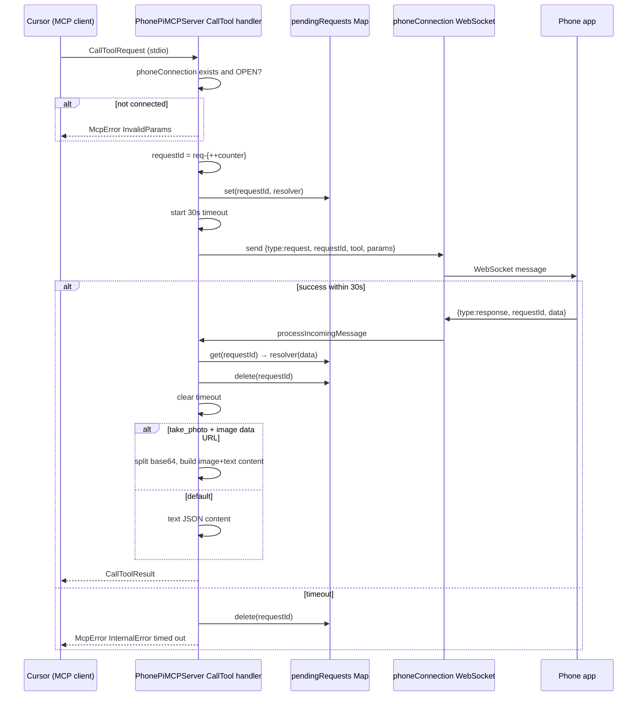
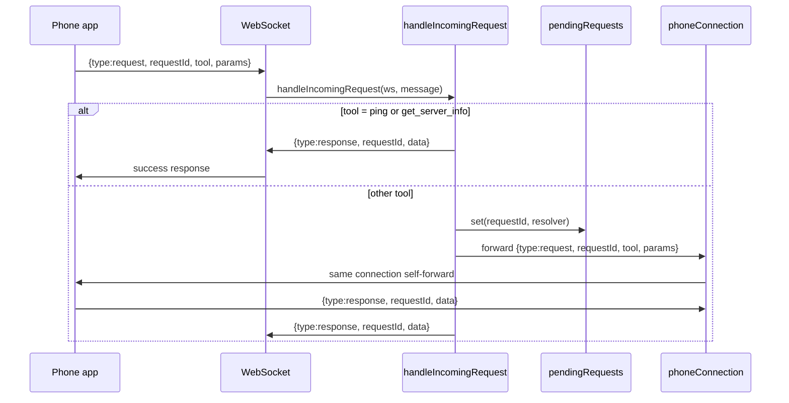

# MCP-to-phone forwarding flow

> **Subagent:** `4e489a23` — **Complete**  
> **Source:** `server/src/index.ts`

## Architecture

The server runs two transports in parallel:

- **MCP stdio** (Cursor → `CallToolRequest`) when started with `--stdio` / `phonepi-mcp start`
- **WebSocket** on port 11041 (default) for the phone app

Both directions share one **`pendingRequests`** map and the same **`phoneConnection`** singleton.

---

## Core state

| Symbol | Role |
|--------|------|
| `pendingRequests` | `Map<requestId, (data) => void>` — resolves in-flight Promises |
| `requestCounter` | MCP-side IDs: `req-1`, `req-2`, … |
| `phoneConnection` | Single active phone WebSocket |
| 30s timeout | `setTimeout` deletes map entry and rejects Promise |

---

## Forward path: MCP CallToolRequest → phone → MCP result

### Step-by-step

1. **Cursor** sends MCP `tools/call` over stdio.
2. **`setupMcpHandlers`** registers `CallToolRequestSchema`.
3. **Pre-checks:** `phoneConnection` must exist and `readyState === OPEN`; else `McpError(InvalidParams)`.
4. **Build outbound WS message:**
   ```json
   { "type": "request", "requestId": "req-N", "tool": "<name>", "params": { ... } }
   ```
5. **Promise + `pendingRequests`:**
   - Start 30s timer; on fire → delete + reject `"Request timed out after 30 seconds"`
   - `pendingRequests.set(requestId, resolver)`
   - `phoneConnection.send(JSON.stringify(message))`
6. **Phone** executes tool and sends `{ type: "response", requestId, data }`.
7. **`processIncomingMessage`:** on `type === "response"`, resolves pending Promise with `message.data`.
8. **MCP result shaping:**
   - **`take_photo` + string response:** parse JSON, extract `data:image/...;base64,...` → MCP `image` + truncated `text`
   - **Default:** single `text` block with `JSON.stringify(response, null, 2)`

### Sequence diagram



---

## Reverse path: phone → handleIncomingRequest

### Routing into `handleIncomingRequest`

| Incoming `message.type` | Action |
|-------------------------|--------|
| `pong` | Update `lastPing` only |
| `response` | Resolve `pendingRequests` |
| `request` | `handleIncomingRequest(ws, message)` |
| `ping` | `handleIncomingRequest(ws, {..., tool:"ping"})` |
| other | Log unknown type |

### `handleIncomingRequest` logic

1. **Validate `requestId`:** missing → silent return (no WS error reply).
2. **Validate `tool`:** missing → error response.
3. **Local tools:** `ping`, `get_server_info` — no phone round-trip.
4. **All other tools:** same Promise/`pendingRequests`/30s pattern; forward to `phoneConnection` (self-forward quirk).
5. **Reply:** `ws.send({type:"response", requestId, data})`.

### Sequence diagram (phone-initiated)



**Note:** For non-local tools, `ws` and `phoneConnection` are usually the same socket. Do not rely on self-forward for production phone→desktop RPC.

---

## Photo / base64 special handling (MCP path only)

`take_photo` is **commented out** in `ListTools` but handler still exists.

Requirements for special path:

- Tool name exactly `take_photo`
- `response` is a **string** (not already-parsed object)
- Parsed JSON has `imageData` starting with `data:image/`

Output:

- Full base64 in MCP `image` content block
- Text block redacts `imageData` to `[mime image data]` but includes truncated `imageDataForAnalysis` (up to 10,000 chars)

---

## Edge cases

### Connection and lifecycle

| Case | Behavior |
|------|----------|
| No phone connected | MCP throws `InvalidParams` immediately |
| New phone connects | Old connection closed; **in-flight `pendingRequests` not cleared** |
| 45s ping staleness | Server `terminate()`s connection |
| Shared map collision | MCP `req-N` and phone `requestId` share one map |

### Message format

| Case | Behavior |
|------|----------|
| Invalid JSON on WS | `{type:"error", error:"Invalid JSON format"}` |
| Response with unknown `requestId` | Logged; dropped |
| Late response after timeout | Orphan; logged |

### Error surfacing

| Path | On failure |
|------|------------|
| MCP `CallToolRequest` | Throws `McpError(InternalError)` to Cursor |
| `handleIncomingRequest` | Errors in `data: {status:"error", error:"..."}` inside WS `response` |

---

## Message contract summary

**Server → phone (tool invoke):**

```json
{ "type": "request", "requestId": "<id>", "tool": "<name>", "params": {} }
```

**Phone → server (tool result):**

```json
{ "type": "response", "requestId": "<id>", "data": <any> }
```

**Keepalive:**

- Server → phone: `{ "type": "ping" }` every 15s
- Phone → server: `{ "type": "pong" }`
