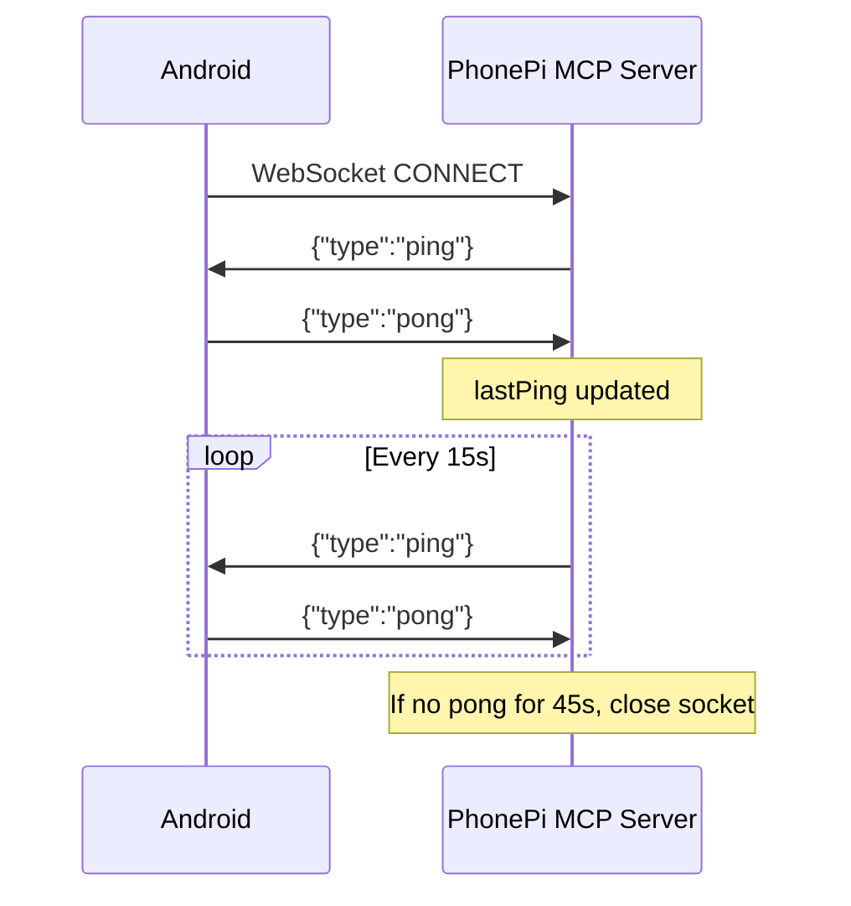
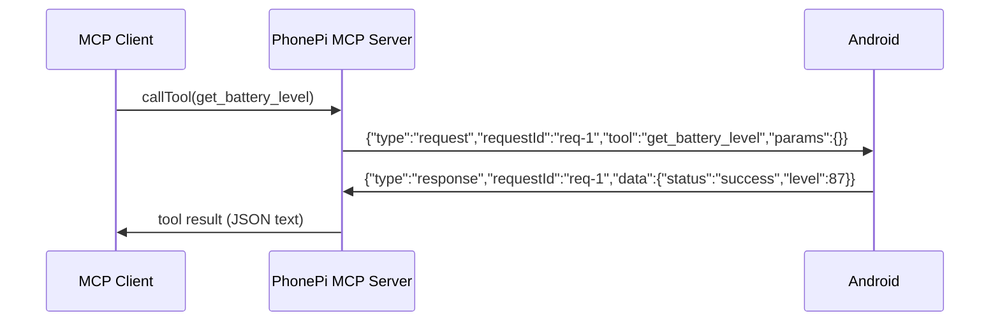

# WebSocket protocol spec (Android client)

> **Subagent:** `f772daec` — **Complete**  
> **Source:** `server/src/index.ts`

## Overview

| Item | Value |
|------|--------|
| Transport | WebSocket (RFC 6455) |
| Default URL | `ws://<host>:11041` |
| Subprotocol | None |
| Auth | None at WebSocket layer |
| Payload | UTF-8 JSON text frames |
| Role of Android | **Phone client** — one active connection per server |
| MCP layer | Separate; server bridges MCP (stdio) ↔ WebSocket phone |

---

## Connection handshake

There is **no application-level handshake** beyond the standard WebSocket upgrade.

### Android connects

1. Open WebSocket to `ws://<desktop-ip>:<port>` (default port **11041**).
2. Server accepts all clients (`verifyClient` always returns `true`).
3. Server may use **per-message deflate** compression for frames ≥ 1024 bytes.

### Server behavior on connect

- If an existing connection exists, it is **closed** (single-phone model).
- Server sets `phoneConnection` and sends immediate `{"type":"ping"}`.

**Android must:**

1. Expect `{"type":"ping"}` right after the socket opens.
2. Reply with `{"type":"pong"}`.
3. Be ready to receive `request` messages at any time.

### Reconnection

On disconnect, Android should reconnect with backoff. The server does not queue requests while offline; MCP tool calls fail with `"Phone not connected"`.

---

## Message envelope

All messages are JSON objects with a required `type` field.

| `type` | Direction (typical) | Purpose |
|--------|---------------------|---------|
| `ping` | Server → Phone | Keepalive probe |
| `pong` | Phone → Server | Keepalive reply |
| `request` | Server → Phone (primary) | Invoke a tool |
| `response` | Phone → Server | Tool result |
| `error` | Server → Phone | Protocol-level parse error |

Unknown `type` values are logged and **ignored** (no reply).

---

## Keepalive: ping / pong

| Parameter | Value |
|-----------|--------|
| Ping interval | **15 seconds** |
| Liveness timeout | **45 seconds** since last `lastPing` update |
| Initial ping | Sent immediately on connect |

### `lastPing` updates when

- Connection opens (`Date.now()`).
- Server receives `{"type":"pong"}`.

Receiving `ping` does **not** update `lastPing`.

### Android rules

**On receive:**

```json
{ "type": "ping" }
```

**Send immediately:**

```json
{ "type": "pong" }
```

- No `requestId` required for `pong`.
- Missing pongs for **> 45s** causes server to terminate the socket.

---

## Request / response (tool calls)

### Server → Phone request

```json
{
  "type": "request",
  "requestId": "req-1",
  "tool": "<tool_name>",
  "params": { }
}
```

| Field | Required | Notes |
|-------|----------|-------|
| `type` | yes | `"request"` |
| `requestId` | yes | Correlation ID; echo in response |
| `tool` | yes | Tool name string |
| `params` | no | Object; defaults to `{}` |

### `requestId` format

- Pattern: **`req-<integer>`** (e.g. `req-1`, `req-2`, …)
- Monotonic counter starting at 1
- Android must echo the **exact** `requestId` in the matching `response`

### Phone → Server response

```json
{
  "type": "response",
  "requestId": "req-1",
  "data": { }
}
```

Server resolves the pending MCP promise with `message.data` directly.

### Response `data` conventions

**Success:**

```json
{ "status": "success", "...": "tool-specific fields" }
```

**Failure (tool-level):**

```json
{
  "status": "error",
  "error": "Human-readable message",
  "timestamp": 1710000000000
}
```

### Timeouts

| Timeout | Value | Applies to |
|---------|-------|------------|
| Tool request | **30 seconds** | Server waiting for phone `response` |
| Keepalive | **45 seconds** | No `pong` since last `lastPing` update |

---

## Error handling

### Protocol `error` (invalid JSON)

```json
{
  "type": "error",
  "error": "Invalid JSON format",
  "originalMessage": "{broken"
}
```

### Tool execution errors (phone side)

Prefer a normal `response` with error payload, not `type: "error"`:

```json
{
  "type": "response",
  "requestId": "req-5",
  "data": {
    "status": "error",
    "error": "Permission denied: READ_CONTACTS"
  }
}
```

### Connection errors

| Condition | Server behavior |
|-----------|-----------------|
| Phone disconnected | MCP `callTool` throws `"Phone not connected"` |
| Socket not OPEN | MCP throws `"Phone connection is not open"` |
| Keepalive timeout | Socket closed; `phoneConnection = null` |
| Send failure | Pending request rejected |

---

## Optional: phone-initiated requests

Locally handled tools on server:

| `tool` | Server response `data` |
|--------|------------------------|
| `ping` | `{ status: "success", message: "pong", timestamp }` |
| `get_server_info` | `{ status: "success", info: { version, uptime, nodeVersion, platform } }` |

All other phone-initiated tools are re-forwarded to the phone (testing stub; do not rely on in production).

---

## Sequence diagrams

### Connect + keepalive



### Tool call (MCP → phone)



---

## Android implementation checklist

### Connection

- [ ] Connect to `ws://<ip>:11041` (configurable port)
- [ ] Handle single-connection replacement (reconnect if kicked)
- [ ] Support optional per-message compression (library default)

### Message loop

- [ ] Parse JSON; send well-formed JSON only
- [ ] Dispatch on `type`: `ping`, `request` (ignore unknown types)

### Keepalive

- [ ] On `ping` → send `pong` immediately
- [ ] Ensure `pong` at least once every **< 45s**

### Tool dispatch

- [ ] On `request`: read `requestId`, `tool`, `params`
- [ ] Execute tool on device (permissions, UI thread, etc.)
- [ ] Reply with `response` + same `requestId` within **30s**
- [ ] Use `data.status: "success"` / `"error"` consistently

---

## Gaps (not defined in server code)

- Exact success payload shapes per tool (only MCP `inputSchema` hints exist).
- Whether Android should send its own periodic `ping` (not required).
- TLS / `wss://` (server listens plain `ws`; VPN like Tailscale recommended in docs).
- Binary frames (server only parses UTF-8 JSON text).
