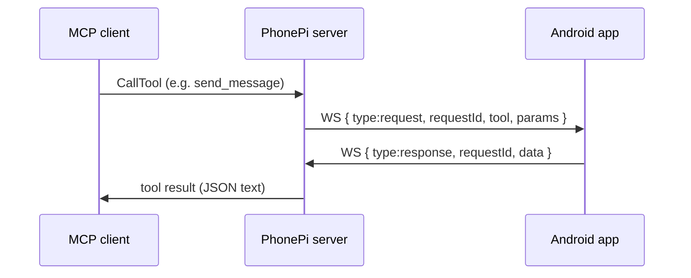
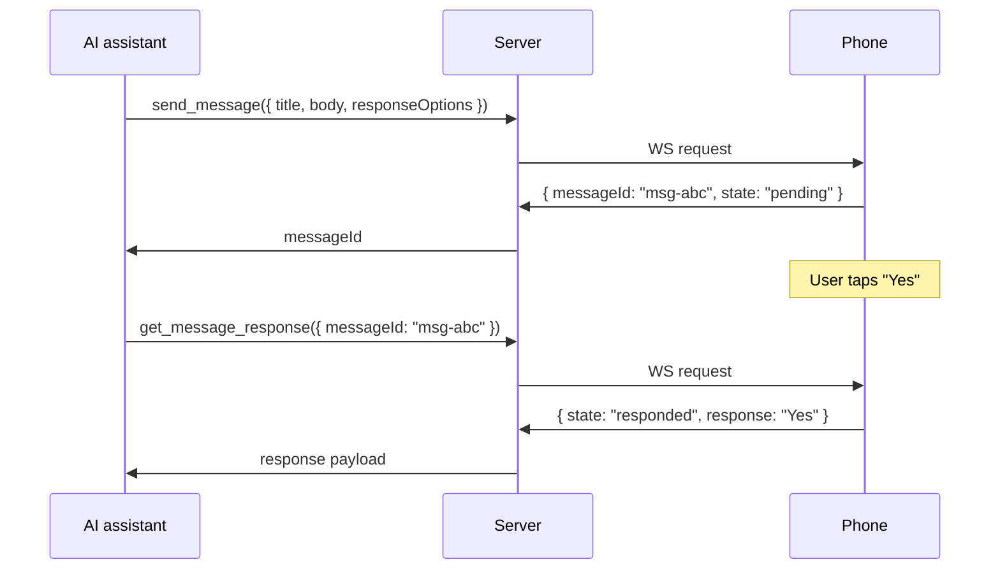

# Comms tools: SMS, calls, notifications, messages

> **Subagents:** `ba8b2cc0` (notifications/messages) — **Complete**; `5bdaf550` (SMS/calls) — **Complete**  
> **Source:** `server/src/index.ts`. The Android companion app is not in this repo; phone-side behavior is inferred from server contracts plus Android platform docs.

All tools are **thin proxies**: server forwards params over WebSocket, waits 30s, returns `data` as JSON text to MCP. No server-side business logic.

- Server performs **no telephony logic** and **no param validation** beyond MCP JSON Schema at discovery time.
- `CallToolRequestSchema` forwards `request.params.arguments || {}` verbatim.
- Phone must reply within **30 seconds** or MCP gets `"Request timed out after 30 seconds"`.
- MCP result is always `{ type: "text", text: JSON.stringify(response, null, 2) }` (except `take_photo`).

---

## Architecture



---

## `send_sms`

### MCP schema (`server/src/index.ts` 741–756)

| Param | Type | Required | Server validation |
|-------|------|----------|-------------------|
| `to` | string | yes | None (no pattern, E.164 check, or length limit) |
| `message` | string | yes | None (no max length, empty-string check) |

| Layer | What happens |
|-------|--------------|
| MCP `ListTools` | JSON Schema: both fields required |
| `CallTool` | Only checks phone WebSocket is connected and OPEN |
| Phone app | **Must** validate `to` and `message` |

### Recommended Android validation

- Reject empty/whitespace-only `to` or `message`.
- Normalize `to`: strip spaces/dashes; accept `+`, digits, optional leading `tel:`.
- Reject obviously invalid numbers (too short, non-digit after normalization).
- Optional: cap `message` length (e.g. 1600 chars); use `SmsManager.divideMessage()` for multipart.
- Optional: user confirmation UI before sending (strongly recommended for DIY).

### WebSocket request

```json
{
  "type": "request",
  "requestId": "req-7",
  "tool": "send_sms",
  "params": { "to": "+15551234567", "message": "Hello from AI" }
}
```

### Response format (recommended)

Success fields are **not defined in server code**; follow `status` convention.

```json
{
  "type": "response",
  "requestId": "req-7",
  "data": { "status": "success", "to": "+15551234567", "messageLength": 13, "parts": 1 }
}
```

| `error` case | Example message |
|--------------|-----------------|
| Missing permission | `SEND_SMS permission not granted` |
| Invalid destination | `Invalid phone number` |
| No telephony | `Device has no SMS capability` |
| `SecurityException` | `SMS send blocked by system` |
| Empty params | `Missing required parameter: to` |

### Android APIs and permissions

| Item | Details |
|------|---------|
| **Primary API** | `android.telephony.SmsManager` |
| **Single-part** | `SmsManager.getDefault().sendTextMessage(to, null, message, sentIntent, deliveryIntent)` |
| **Multipart** | `divideMessage(message)` then `sendMultipartTextMessage(...)` |
| **Dual-SIM** | `SmsManager.getSmsManagerForSubscriptionId(subId)` / `createForSubscriptionId()` |
| **Feature** | `PackageManager.FEATURE_TELEPHONY_MESSAGING` |
| **Manifest** | `android.permission.SEND_SMS` |
| **Runtime** | Request `SEND_SMS` before first send (API 23+) |

**Not required for basic send:** `READ_SMS`, `RECEIVE_SMS`, `WRITE_SMS`, default SMS app role.

**Google Play policy (critical):** Play restricts SMS permission groups — apps that are **not** the default SMS/Assistant handler generally **cannot** declare `SEND_SMS` on Play Store. **Sideloaded / personal DIY builds** can still use `SEND_SMS` at OS level. Official PhonePi likely has an exception declaration or alternate implementation.

**Weaker alternative:** `Intent.ACTION_SENDTO` with `sms:<number>` opens the composer; user must tap Send. Does not match unattended AI send. `share_snippet` with `method: "sms"` is a separate tool path.

```kotlin
fun handleSendSms(to: String, message: String): ToolResult {
    if (!hasPermission(Manifest.permission.SEND_SMS))
        return error("SEND_SMS permission not granted")
    val dest = normalizePhone(to) ?: return error("Invalid phone number")
    if (message.isBlank()) return error("Message cannot be empty")
    val sms = SmsManager.getDefault()
    val parts = sms.divideMessage(message)
    if (parts.size == 1) sms.sendTextMessage(dest, null, message, null, null)
    else sms.sendMultipartTextMessage(dest, null, parts, null, null)
    return success(mapOf("to" to dest, "messageLength" to message.length, "parts" to parts.size))
}
```

Run telephony work off the main thread; respond within 30s.

---

## `make_call`

### MCP schema (`server/src/index.ts` 758–770)

| Param | Type | Required | Server validation |
|-------|------|----------|-------------------|
| `to` | string | yes | None (connection check only) |

### WebSocket request

```json
{
  "type": "request",
  "requestId": "req-8",
  "tool": "make_call",
  "params": { "to": "+15559876543" }
}
```

### Response format (recommended)

```json
{
  "type": "response",
  "requestId": "req-8",
  "data": { "status": "success", "to": "+15559876543" }
}
```

Success means the dial intent was started, not that the call connected.

### Android APIs — two approaches

| Approach | API | Permission | Matches tool intent? |
|----------|-----|------------|----------------------|
| **Direct call (recommended)** | `Intent(ACTION_CALL, Uri.parse("tel:$number"))` + `startActivity()` | `CALL_PHONE` (manifest + runtime) | Yes — "Make a phone call" |
| **Dialer handoff** | `Intent(ACTION_DIAL, Uri.parse("tel:$number"))` | None | No — user must press Call |
| **Default dialer only** | `TelecomManager.placeCall(uri, extras)` | `CALL_PHONE`; app must be `ROLE_DIALER` | Yes, but heavy requirement |

PhonePi marketing ("Initiate phone calls from your AI assistant") implies **`ACTION_CALL`**, not `ACTION_DIAL`.

```xml
<uses-permission android:name="android.permission.CALL_PHONE" />
<uses-feature android:name="android.hardware.telephony" android:required="false" />
```

```kotlin
fun handleMakeCall(to: String): ToolResult {
    if (!hasPermission(Manifest.permission.CALL_PHONE))
        return error("CALL_PHONE permission not granted")
    val dest = normalizePhone(to) ?: return error("Invalid phone number")
    context.startActivity(
        Intent(Intent.ACTION_CALL, Uri.parse("tel:$dest"))
            .addFlags(Intent.FLAG_ACTIVITY_NEW_TASK))
    return success(mapOf("to" to dest))
}
```

**TelecomManager notes:** `placeCall()` is for apps filling `RoleManager.ROLE_DIALER`. A companion MCP client should **not** require default-dialer role; use `ACTION_CALL`. Emergency numbers may reroute non-default dialers through `ACTION_DIAL`. Background `startActivity` is restricted on newer Android; use a foreground service or bring app to foreground first.

**Not required:** `READ_PHONE_STATE` (only for call-state monitoring), `PROCESS_OUTGOING_CALLS` (deprecated/restricted).

---

## Shared telephony client requirements

### Phone number normalization

```kotlin
fun normalizePhone(raw: String): String? {
    val s = raw.trim().removePrefix("tel:")
    val digits = s.filter { it.isDigit() || it == '+' }
    if (digits.count { it.isDigit() } < 7) return null
    return digits
}
```

### Telephony security implications

| Risk | Mitigation for DIY app |
|------|------------------------|
| **AI prompt injection** | "Call this premium number" / "SMS everyone" — confirmation UI, allowlists, per-tool toggles |
| **Cost attacks** | Premium/short codes, international calls — block non-local prefixes or require confirmation |
| **Spam** | Rapid-fire SMS — rate limit per minute |
| **Social engineering** | Messages sent as device owner — disclose AI can send SMS |
| **Play Protect (sideload)** | Apps with `SEND_SMS` from internet sideload may be blocked |

`SEND_SMS` and `CALL_PHONE` are **dangerous** permissions; granted once, retained until revoked. Combine with [local-security.md](../04-security/local-security.md) pairing + per-tool enable switches (`send_sms` off by default).

### Manifest snippet

```xml
<uses-permission android:name="android.permission.SEND_SMS" />
<uses-permission android:name="android.permission.CALL_PHONE" />
<uses-permission android:name="android.permission.INTERNET" />
<uses-permission android:name="android.permission.FOREGROUND_SERVICE" />
<uses-permission android:name="android.permission.FOREGROUND_SERVICE_DATA_SYNC" />
<uses-feature android:name="android.hardware.telephony" android:required="false" />
```

**Emulator note:** SMS and telephony often fail or behave oddly on emulators; plan for physical device testing.

---

## `send_notification`

**Purpose:** One-way push notification; no user response expected.

### MCP params

| Param | Type | Required | Default |
|-------|------|----------|---------|
| `title` | string | yes | — |
| `body` | string | yes | — |
| `priority` | string | no | `"default"` — `default` \| `high` |
| `data` | object | no | Arbitrary key/value payload |

### Inferred response `data`

```json
{ "status": "success" }
```

Optional: `notificationId`, `channelId`, `postedAt`.

### Android implementation

- `NotificationManager` on dedicated channel.
- `priority: "default"` → `IMPORTANCE_DEFAULT`
- `priority: "high"` → `IMPORTANCE_HIGH` (heads-up)
- `data` → `Notification.extras` or `PendingIntent` extras

---

## `send_message`

**Purpose:** Interactive message requiring user attention; optional response capture.

### MCP params

| Param | Type | Required | Default |
|-------|------|----------|---------|
| `title` | string | yes | — |
| `body` | string | yes | — |
| `priority` | string | no | `"normal"` — `low` \| `normal` \| `high` \| `urgent` |
| `responseOptions` | string[] | no | Button/choice labels |
| `requireResponse` | boolean | no | `false` |
| `expiresIn` | number | no | `0` — expiration in **minutes**; `0` = never |

### Two-step response pattern

Because MCP has a **30s** timeout, `send_message` returns **immediately** with `messageId`, not the user's answer:



### Inferred `send_message` response

```json
{
  "status": "success",
  "messageId": "<opaque-string>",
  "state": "pending"
}
```

---

## `get_message_response`

| Param | Type | Required |
|-------|------|----------|
| `messageId` | string | yes |

### Inferred response states

| `state` | Meaning |
|---------|---------|
| `pending` | User has not responded |
| `responded` | User chose an option or entered text |
| `expired` | `expiresIn` elapsed |
| `dismissed` | User dismissed without responding |
| `not_found` | Unknown `messageId` |

Example:

```json
{
  "status": "success",
  "messageId": "msg-abc",
  "state": "responded",
  "response": "Yes",
  "responseIndex": 0,
  "respondedAt": 1719158400000
}
```

---

## Foreground service and notification channels

| Requirement | Why |
|-------------|-----|
| `FOREGROUND_SERVICE` + `FOREGROUND_SERVICE_DATA_SYNC` or `CONNECTED_DEVICE` | Keep WebSocket alive when backgrounded |
| Ongoing low-priority notification | Android 8+ FGS requirement |
| `POST_NOTIFICATIONS` (API 33+) | Runtime permission |

### Recommended channels

| Channel | Used by | Importance |
|---------|---------|------------|
| `mcp_connection` | Foreground service | LOW |
| `mcp_notifications` | `send_notification` default | DEFAULT |
| `mcp_notifications_high` | `send_notification` high | HIGH |
| `mcp_messages` | `send_message` low/normal | DEFAULT |
| `mcp_messages_urgent` | `send_message` high/urgent | HIGH / full-screen intent |

### `send_message` storage

Store `{ messageId, title, body, responseOptions, requireResponse, expiresAt, state }` in Room/SQLite.

- `responseOptions` → `NotificationCompat.Action` per option
- `expiresIn > 0` → `AlarmManager` / WorkManager to mark expired

---

## Priority mapping

| Tool | Server enum | Android mapping |
|------|-------------|-----------------|
| `send_notification` | `default`, `high` | `IMPORTANCE_DEFAULT`, `IMPORTANCE_HIGH` |
| `send_message` | `low`, `normal`, `high`, `urgent` | LOW, DEFAULT, HIGH, HIGH + full-screen |

---

## Gaps

1. No response schemas validated by server.
2. 30s timeout prevents long-poll on `get_message_response`; AI must call repeatedly.
3. No Android source in repo for exact `messageId` format.
