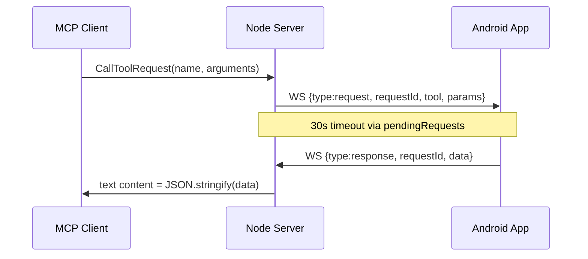

# Device tools: battery, find_phone, timer, clipboard

> **Subagents:** `b1623973` (battery/timer/find_phone) — **Complete**; `6c0325c7` (clipboard) — **Complete**  
> **Source:** `server/src/index.ts`

All four active tools use the same MCP → phone WebSocket path with **no server-side validation** of params or response shapes. The server JSON-stringifies `response.data` verbatim.

---

## Shared forwarding pattern



| Tool | Server validates params? | Special MCP handling? |
|------|--------------------------|------------------------|
| `get_battery_level` | No | No |
| `find_phone` | No | No |
| `set_timer` | No | No |
| `copy_to_clipboard` | No | No |

---

## `get_battery_level`

| Property | Value |
|----------|-------|
| **Params** | none |
| **Description** | Get current battery level |

### Inferred response `data`

```json
{
  "status": "success",
  "level": 72,
  "isCharging": false,
  "chargingStatus": "discharging"
}
```

### Android APIs

| API | Usage |
|-----|-------|
| `BatteryManager` | `getIntProperty(BATTERY_PROPERTY_CAPACITY)` (API 21+) |
| `Intent.ACTION_BATTERY_CHANGED` | Sticky broadcast for level/status |

**Permissions:** none for basic battery level.

---

## `find_phone`

| Property | Value |
|----------|-------|
| **Params** | optional `loop`, `showDismissUI`, `notifyOnCompletion` (boolean) |

| Param | Default | Behavior |
|-------|---------|----------|
| `loop` | `true` | Loop alarm/beep until user dismisses |
| `showDismissUI` | `true` | Full-screen or overlay dismiss UI |
| `notifyOnCompletion` | `false` | Post notification when beeping ends |

Phone should apply defaults when keys are missing.

### Inferred response `data`

With `loop: true`, acknowledge start quickly (within 30s):

```json
{
  "status": "success",
  "message": "Find phone alert started",
  "looping": true,
  "sessionId": "find-abc123"
}
```

### Android APIs

| API | Usage |
|-----|-------|
| `Ringtone` / `RingtoneManager` | Default alarm URI; `isLooping = true` |
| `MediaPlayer` | Alternative for looped audio |
| `AudioManager` | `STREAM_ALARM`, audio focus |
| `Vibrator` / `VibrationEffect` | Optional haptic |
| `ForegroundService` | Keep audio alive when backgrounded |
| `WakeLock` | Prevent CPU sleep during alert |
| `NotificationManager` | `notifyOnCompletion` notification |

**Permissions:** `POST_NOTIFICATIONS` (API 33+), `VIBRATE` (optional), FGS type `mediaPlayback` or `specialUse` (API 14+).

**Counterpart:** commented `stop_alarm` tool stops looping sessions.

---

## `set_timer`

| Property | Value |
|----------|-------|
| **Required params** | `seconds` (number, minimum 1) |

### Inferred response `data`

```json
{
  "status": "success",
  "message": "Timer set for 300 seconds",
  "identifier": "timer-req-7",
  "seconds": 300,
  "firesAt": "2026-06-23T15:35:00.000Z"
}
```

Return `identifier` for future `cancel_alarm_or_timer` (commented tool).

### Android APIs

| API | Usage |
|-----|-------|
| `AlarmManager` | `setExactAndAllowWhileIdle(ELAPSED_REALTIME_WAKEUP, ...)` |
| `PendingIntent` + `BroadcastReceiver` | Fire at timer end |
| `CountDownTimer` | In-process only; **not** suitable if app can be killed |
| `Ringtone` / `NotificationManager` | Completion sound/notification |

**Permissions:** `SCHEDULE_EXACT_ALARM` (API 12+) or `USE_EXACT_ALARM`; `POST_NOTIFICATIONS` (API 33+).

**Design:** Use `AlarmManager` + `PendingIntent` for production; `CountDownTimer` alone will not survive process death.

---

## Commented alarm tools (related)

See [disabled-tools-roadmap.md](disabled-tools-roadmap.md) for `set_alarm`, `cancel_alarm_or_timer`, `stop_alarm`.

---

## `copy_to_clipboard`

| Property | Value |
|----------|-------|
| **Required params** | `text` (string) |

**Related:** `share_snippet` with `method: "clipboard"` is a separate code path.

### Inferred response `data`

**Success:**

```json
{
  "status": "success",
  "message": "Text copied to clipboard",
  "length": 42
}
```

**Failure (background):**

```json
{
  "status": "error",
  "error": "App not in foreground; clipboard write blocked (Android 10+)"
}
```

### Android `ClipboardManager`

```kotlin
val clipboard = context.getSystemService(Context.CLIPBOARD_SERVICE) as ClipboardManager
val clip = ClipData.newPlainText("phonepi", text)
clipboard.setPrimaryClip(clip)
```

| Item | Detail |
|------|--------|
| **Permission** | None for write |
| **Thread** | Main thread |
| **API 13+** | System shows copy confirmation; do not duplicate with Toast |

### Background restrictions (API 29+)

| Rule | Impact |
|------|--------|
| Write blocked without focus | App must have **window focus** or be default IME |
| FGS alone | **Not** enough for clipboard write |

**Required pattern:**

1. Receive WebSocket `request` on background thread.
2. If no window focus → bring Activity to foreground or show high-priority notification with action.
3. Copy in `onWindowFocusChanged(true)` or `onResume` after focus confirmed.
4. Reply on WebSocket with `status`.

---

## Implementation priority

1. **Phase 1:** `get_battery_level`, `set_timer`, `copy_to_clipboard`
2. **Phase 2:** `find_phone` (needs FGS + audio)
3. **Shared:** WebSocket handler, `{status, error}` envelope, FGS for audio-heavy tools
