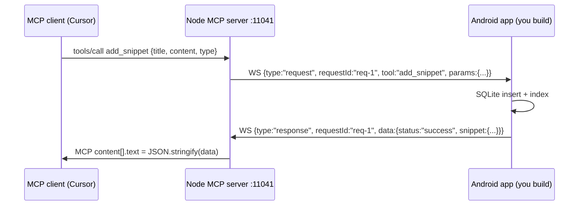

# Snippet tools subsystem

> **Subagent:** `2131b5b2` — **Complete**  
> **Source:** `server/src/index.ts` (lines 615–739, 1157–1181). This repo contains only the desktop MCP server; the official Android app source is not published. Snippet **response shapes are not defined anywhere in the codebase** — the server forwards `data` from the phone and JSON-stringifies it. Response/storage details are derived from tool schemas, protocol patterns, and standard Android CRUD/share behavior.

## Architecture overview



The phone is a **WebSocket client** that connects **to** the server (server listens on `0.0.0.0:11041`). Only **one** phone connection is kept; a new connection replaces the old one.

---

## Wire protocol

### Inbound (server → phone)

```json
{ "type": "request", "requestId": "req-42", "tool": "add_snippet", "params": {} }
```

| Field | Type | Notes |
|-------|------|-------|
| `type` | `"request"` | Fixed |
| `requestId` | `string` | Server uses `req-{counter}` for MCP calls |
| `tool` | `string` | One of the 8 snippet tool names |
| `params` | `object` | Tool arguments; may be `{}` |

**Timeout:** Server waits **30 seconds** for a response, then fails the MCP call.

### Outbound (phone → server)

```json
{ "type": "response", "requestId": "req-42", "data": {} }
```

`requestId` **must match** the inbound request. `data` is returned verbatim to the MCP client as pretty-printed JSON text.

### Keepalive

| Direction | Message |
|-----------|---------|
| Server → phone | `{"type":"ping"}` every **15s** |
| Phone → server | `{"type":"pong"}` |
| Timeout | Server drops connection if no pong within **45s** |

### Response envelope convention (inferred)

```json
{ "status": "success", ... }
{ "status": "error", "error": "human-readable message", "timestamp": 1719158400000 }
```

Follow the `status` / `error` convention for all snippet tools so AI clients get predictable results.

---

## Snippet domain model

### Snippet type enum

| Value | MCP usage |
|-------|-----------|
| `"note"` | General text note |
| `"todo"` | Task / checklist item |
| `"bookmark"` | Saved link or reference |
| `"snippet"` | Generic reusable text (code, quotes, etc.) |
| `"draft"` | Unfinished / work-in-progress content |

No semantic rules are defined in code beyond the enum. You may add per-type UI behavior on Android.

### Snippet entity (recommended canonical model)

| Field | Wire type | Required on entity | Notes |
|-------|-----------|-------------------|-------|
| `id` | `number` (integer) | Yes | Auto-increment locally; returned after create |
| `title` | `string` | Yes | |
| `content` | `string` | Yes | Body text; for `bookmark`, often a URL |
| `type` | `SnippetType` | Yes | One of 5 enum values |
| `tags` | `string` (comma-separated) | Optional | e.g. `"work,api,urgent"`; parse to `List<String>` internally |
| `createdAt` | `number` (epoch ms) | Recommended | Not in MCP schema; useful for sort order |
| `updatedAt` | `number` (epoch ms) | Recommended | Set on every update |

### Tags wire format

- **Input:** single `string`, comma-separated: `"tag1,tag2,tag3"`
- **Storage:** normalize to trimmed lowercase tokens; reject empty segments
- **Output:** join back with `", "` or `","` (pick one and stay consistent)

---

## Tool-by-tool specification

### 1. `add_snippet`

Add a new snippet to the phone.

| Param | Type | Required | Description |
|-------|------|----------|-------------|
| `title` | `string` | Yes | Title |
| `content` | `string` | Yes | Body |
| `type` | `SnippetType` | Yes | Category |
| `tags` | `string` | No | Comma-separated tags |

**Android behavior:** validate fields → insert row → assign monotonic integer `id` → parse optional `tags` → return created snippet.

```json
{
  "status": "success",
  "snippet": { "id": 1, "title": "Meeting notes", "content": "Discuss Q3 roadmap", "type": "note", "tags": "work,meetings" }
}
```

Error: `{ "status": "error", "error": "title is required" }`

### 2. `get_all_snippets`

No params. Query all rows (suggest sort `updatedAt DESC` or `id DESC`).

```json
{
  "status": "success",
  "snippets": [ { "id": 1, "title": "...", "content": "...", "type": "note", "tags": "work" } ],
  "count": 1
}
```

### 3. `get_snippet_by_id`

| Param | Type | Required |
|-------|------|----------|
| `id` | `number` | Yes |

Found: `{ "status": "success", "snippet": {...} }`  
Not found: `{ "status": "error", "error": "Snippet not found: id=3" }`

### 4. `get_snippets_by_type`

| Param | Type | Required | Enum |
|-------|------|----------|------|
| `type` | `string` | Yes | `note`, `todo`, `bookmark`, `snippet`, `draft` |

```json
{ "status": "success", "type": "todo", "snippets": [ ... ], "count": 2 }
```

### 5. `search_snippets`

| Param | Type | Required |
|-------|------|----------|
| `query` | `string` | Yes |

Behavior (recommended): case-insensitive match against `title`, `content`, and individual `tags`. Empty query → prefer error `"query is required"`. Use SQLite FTS5 or `LIKE '%query%'` for MVP.

```json
{ "status": "success", "query": "api", "snippets": [ ... ], "count": 1 }
```

### 6. `update_snippet`

Full field replacement (not a partial PATCH).

| Param | Type | Required |
|-------|------|----------|
| `id` | `number` | Yes |
| `title` | `string` | Yes |
| `content` | `string` | Yes |
| `type` | `SnippetType` | Yes |
| `tags` | `string` | No |

Omitted `tags` should clear tags or leave unchanged; **recommend clearing to empty string** when omitted for predictable AI behavior. Verify `id` exists → replace all fields → bump `updatedAt` → return updated snippet.

### 7. `delete_snippet`

| Param | Type | Required |
|-------|------|----------|
| `id` | `number` | Yes |

```json
{ "status": "success", "deleted": true, "id": 2 }
```

### 8. `share_snippet`

Share a snippet via messaging apps.

| Param | Type | Required | Default | Enum |
|-------|------|----------|---------|------|
| `id` | `number` | Yes | — | — |
| `method` | `string` | No | `"default"` | `default`, `sms`, `whatsapp`, `clipboard` |
| `recipient` | `string` | Conditional | — | Phone number for `sms` / `whatsapp` |

| Method | Android API | Behavior |
|--------|-------------|----------|
| `default` | `Intent.ACTION_SEND` | System share sheet; share `title + "\n\n" + content` as `text/plain` |
| `sms` | `SmsManager` | Requires `recipient`; send formatted snippet text |
| `whatsapp` | `Intent` with `wa.me` / `com.whatsapp` | Requires `recipient`; `https://api.whatsapp.com/send?phone=...&text=...` |
| `clipboard` | `ClipboardManager` | Copy snippet text; no UI |

Validation: `sms`/`whatsapp` without `recipient` → error; unknown `id` → error.

```json
{ "status": "success", "shared": true, "method": "clipboard", "id": 5 }
```

**Permissions:** `SEND_SMS` for `sms`; WhatsApp needs no special permission (intent-based); clipboard needs none for app-local copy on modern Android.

---

## Local storage and indexing (Android)

| Layer | Choice | Rationale |
|-------|--------|-----------|
| DB | **Room** on SQLite | Matches CRUD + query-by-type + FTS |
| ID | `INTEGER PRIMARY KEY AUTOINCREMENT` | MCP uses `number` ids |
| Search | **FTS5** virtual table synced with main table | Powers `search_snippets` efficiently |
| DI | Repository pattern | One `SnippetRepository` called from WebSocket handler |

### Suggested schema

```sql
CREATE TABLE snippets (
  id          INTEGER PRIMARY KEY AUTOINCREMENT,
  title       TEXT NOT NULL,
  content     TEXT NOT NULL,
  type        TEXT NOT NULL CHECK(type IN ('note','todo','bookmark','snippet','draft')),
  tags        TEXT NOT NULL DEFAULT '',
  created_at  INTEGER NOT NULL,
  updated_at  INTEGER NOT NULL
);

CREATE INDEX idx_snippets_type ON snippets(type);
CREATE INDEX idx_snippets_updated ON snippets(updated_at DESC);

CREATE VIRTUAL TABLE snippets_fts USING fts5(
  title, content, tags,
  content='snippets', content_rowid='id'
);
```

### Notes

- Store `tags` as comma-separated string in main table; also index tag text in FTS. Optional `snippet_tags` junction table only if you need tag-centric queries later.
- Use DB auto-increment; never reuse deleted ids. MCP always sends `id` as JSON **number** (not string).
- Single WebSocket thread dispatches tool calls; use Room transactions for writes. Only one phone connection is allowed; no multi-device sync in current protocol.

---

## WebSocket handler routing (pseudocode)

```kotlin
when (message.tool) {
  "add_snippet" -> snippetRepo.add(params)
  "get_all_snippets" -> snippetRepo.getAll()
  "get_snippet_by_id" -> snippetRepo.getById(params.id)
  "get_snippets_by_type" -> snippetRepo.getByType(params.type)
  "search_snippets" -> snippetRepo.search(params.query)
  "update_snippet" -> snippetRepo.update(params)
  "delete_snippet" -> snippetRepo.delete(params.id)
  "share_snippet" -> snippetShareService.share(params)
  else -> error("Unknown tool: ${message.tool}")
}
```

The server does **no snippet-specific transformation**; whatever you put in `data` becomes `content[].text = JSON.stringify(data)`. Design responses to be self-describing (`status`, `snippet`/`snippets`, `count`, `error`).

---

## Feature parity checklist

| Tool | In `ListTools` | Phone must implement |
|------|----------------|---------------------|
| `add_snippet` | Yes | Create + persist |
| `get_all_snippets` | Yes | List all |
| `get_snippet_by_id` | Yes | Read by id |
| `get_snippets_by_type` | Yes | Filter by type |
| `search_snippets` | Yes | Full-text / substring search |
| `update_snippet` | Yes | Full replace update |
| `delete_snippet` | Yes | Hard delete |
| `share_snippet` | Yes | Share sheet / SMS / WhatsApp / clipboard |

---

## Test matrix

| Test | Input | Expected |
|------|-------|----------|
| Create | `add_snippet` with all fields | `status: success`, `id` assigned |
| Create minimal | no `tags` | `tags: ""` in response |
| List | `get_all_snippets` | includes new snippet |
| Filter | `get_snippets_by_type: "todo"` | only todos |
| Search | `search_snippets: "roadmap"` | matches title/content/tags |
| Read | `get_snippet_by_id` | single object |
| Update | change title | `get` reflects change |
| Delete | `delete_snippet` | subsequent `get` errors |
| Share clipboard | `method: "clipboard"` | text on clipboard |
| Bad id | `id: 99999` | `status: error` |
| Timeout | block handler 35s | MCP client gets timeout error |

---

## Gaps and risks for DIY implementation

1. **No official response contract** — you define it; test against real MCP clients (Cursor) early.
2. **No Android reference** in this repo — cannot verify exact field names the paid app returns (`snippet` vs `data`, etc.).
3. **`tags` optional on add but required fields on update** — handle both `null` omission and `""`.
4. **`share_snippet` + `whatsapp`** — package availability varies; fall back to `default` share sheet with a warning if WhatsApp missing.
5. **No auth on WebSocket** — anyone on your LAN/tailnet can invoke snippet tools once connected; consider a pairing token in your fork.

For wire-compat with the commercial app, capture live WebSocket traffic from a test device and adjust response field names to match observed payloads.
