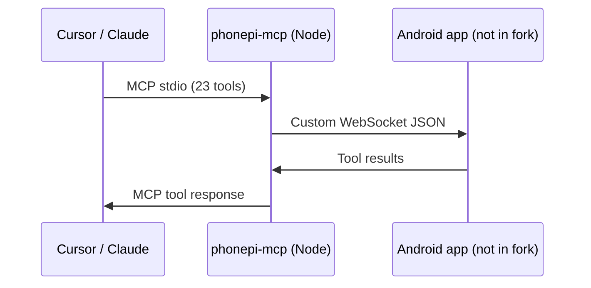
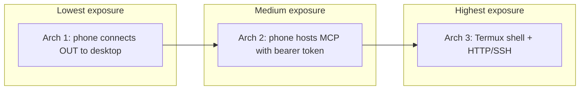

# Alternative architectures

> **Subagent:** `67f7b16a` — **Complete**  
> **Source:** Read-only web research (GitHub API, [phonepimcp.com](https://phonepimcp.com), [MCP transports spec](https://modelcontextprotocol.io/docs/concepts/transports)) + `server/src/index.ts`.

## Recommendation

**Architecture 1 (WebSocket client)** is the best fit: it reuses your entire server/CLI investment, matches official PhonePi design, and is easiest to test. Harden it with bearer-token auth (borrowed from premex-ab/phone-mcp). **Architecture 2 (native Android MCP)** is the right follow-on only if you want phone-only operation without a desktop process. **Termux+Node** is a prototyping path, not a production default.

---

## Your fork today

`F:\Codeing Project\phonepi-mcp` contains the **desktop half** only:

| Component | Role |
|-----------|------|
| `server/` | Node MCP server: stdio to Cursor/Claude, WebSocket bridge on **11041** |
| `phonepi-cli/` | Anthropic-powered CLI that auto-starts the server |

The Android app is **not** in this repo.



The WebSocket layer is a **custom protocol** (`ping`/`pong`, `request`/`response` with `requestId` + `tool`), not standard MCP transport. The server accepts all clients with no auth (`verifyClient` returns `true`, binds `0.0.0.0`).

Registered tools (23 referenced; 22 active): battery, snippets (8), SMS/call, find_phone, timer, clipboard, contacts (5), share_snippet, send_message, get_message_response, send_notification.

---

## Architecture 1: Android as pure WebSocket client

Thin Android app that connects outbound to the existing Node server. Official PhonePi design.

### Fit with your fork

| Dimension | Score | Notes |
|-----------|-------|-------|
| Code reuse | **Excellent** | Server, CLI, tool schemas, server-manager stay as-is |
| Feature parity | **Full** | Protocol already defined; app implements tool handlers |
| Effort | **Medium** | Build Kotlin/Compose app; no server rewrite |

### Testing

- **Server:** mock WebSocket client in Node; unit-test tool schemas and routing.
- **Android:** instrumented tests per tool handler; manual device tests for SMS/calls.
- **E2E:** `phonepi-mcp start` + app connect + Cursor tool call.

### Security

| Pro | Con |
|-----|-----|
| Desktop stays MCP boundary; phone never exposed as MCP endpoint | No auth today; anyone on LAN can connect |
| Tailscale recommended by PhonePi docs | Server binds `0.0.0.0` |
| Permissions gated on Android side | Plain `ws://` on local network |

**Hardening to add:** shared secret or bearer token on WebSocket handshake, optional `wss://` via Tailscale or local TLS, IP allowlist.

---

## Architecture 2: Native Android MCP server (premex-ab/phone-mcp style)

From [premex-ab/phone-mcp](https://github.com/premex-ab/phone-mcp):

- Kotlin app runs **SSE MCP server** on-device (Ktor, default port **3001**).
- Cursor connects directly: `http://device:3001/sse` with **Bearer token**.
- Modular tools: SMS, SMS Intent, camera, contacts (read), sensors, external ContentProvider tools.
- Uses official `io.modelcontextprotocol:kotlin-sdk`.
- Foreground service, per-tool permission toggles, Android Keystore for tokens.

### Fit with your fork

| Dimension | Score | Notes |
|-----------|-------|-------|
| Code reuse | **Low** | Node server becomes optional; rewrite tools in Kotlin |
| Feature parity | **Partial** | Missing PhonePi-specific: snippets (8), interactive messages, share_snippet, find_phone UI, rich contact CRUD |
| Effort | **High** | Full Android MCP stack + port 23 tools |

### Security

| Pro | Con |
|-----|-----|
| Bearer token auth built in | Phone becomes network-exposed MCP endpoint |
| Per-tool enable/disable + disclaimers | Must configure TLS for remote use |
| Permission verification before execution | Cursor must reach phone IP (Tailscale/VPN) |
| Follows MCP Streamable HTTP guidance | More attack surface than outbound-only client |

**Best when:** you want **no desktop process** and phone-only operation.

---

## Architecture 3: Termux + Node hybrid

### 3a. Run your Node server inside Termux

```
Termux: npx phonepi-mcp start (binds 11041)
Minimal Android UI: connects to localhost or forwards port
Desktop Cursor: connects via Tailscale to phone IP
```

- **Reuse:** High (same `server/` code). **Reliability:** Poor — Termux killed by OEM battery optimization. **Security:** Same as Arch 1, plus Termux shell access.

### 3b. [termuxgpt/termux-mcp](https://github.com/termuxgpt/termux-mcp)

- Python HTTP server on port 8080; **not standard MCP**. 60+ HTTP endpoints (shell `/run`, SMS, camera, contacts, cron, git).
- Optional `TERMUX_MCP_AUTH_TOKEN`; defaults to `127.0.0.1`.
- **Parity:** broader raw device access, but **no snippets, no interactive messages**. **Security:** shell execution = large blast radius.

### 3c. [hyhAsma/termux-api-tools-mcp-server](https://github.com/hyhAsma/termux-api-tools-mcp-server)

- Stdio MCP via **SSH from desktop into Termux**. Requires Termux + OpenSSH + Termux:API.
- **Testing:** SSH plumbing fragile. **Security:** SSH credentials + Termux API permissions.

### Fit summary

| Dimension | 3a Node in Termux | 3b termux-mcp | 3c SSH MCP |
|-----------|-------------------|---------------|------------|
| Fork reuse | High | None | None |
| Feature parity | Full (if server stays up) | Different tool set | Partial (Termux-API subset) |
| Testing ease | Hard (background kills) | curl-friendly but flaky | Hardest |
| Production readiness | Low | Low–medium (hacker tool) | Low |

---

## Feature parity matrix

| Capability | Your fork (server) | Arch 1 WS client | premex-ab | termux-mcp |
|------------|-------------------|------------------|-----------|------------|
| 23 PhonePi tools | Server defines all | Full (implement handlers) | ~7 modules, gaps | Overlapping but different |
| Snippets / notes | Yes (8 tools) | Yes | No | No |
| Interactive messages | Yes | Yes | No | Dialog only |
| Contacts CRUD | Full | Full | Read-focused | List only |
| Camera / location | Commented out in server | When you enable | Camera yes | Camera yes |
| Standard MCP to Cursor | Yes (stdio on desktop) | Yes (via desktop) | Yes (SSE on phone) | No (HTTP) or via SSH |
| No desktop required | No | No | **Yes** | Partial |
| Bearer auth | No | Easy to add | **Yes** | Optional |

---

## Security comparison



| Risk | Arch 1 | Arch 2 | Termux |
|------|--------|--------|--------|
| Unauthenticated LAN access | **High today** (fixable) | Low (token required) | Varies |
| DNS rebinding to local MCP | N/A (not HTTP MCP on phone) | Must follow MCP HTTP guidance | HTTP servers need care |
| Shell escape | None | None | **High** (termux-mcp `/run`) |
| OEM background kill | App only | Foreground service | **Termux process** |
| Supply chain | npm + Play Store | Gradle + Play Store | pip + Termux packages |

---

## Recommendation detail

### Primary path: Architecture 1 + security hardening

1. **100% server/CLI reuse.** `server/src/index.ts` already defines the contract; build only the missing Android companion.
2. **Matches official PhonePi design** at [phonepimcp.com](https://phonepimcp.com).
3. **Fastest path to feature parity** with all 23 tools, including snippets and interactive messages that premex-ab and Termux lack.
4. **Easiest testing.** Mock WebSocket in Node; iterate on Android handlers independently.
5. **Best security posture for a LAN tool:** phone initiates outbound; desktop stays the MCP trust boundary.

**Immediate hardening (borrow from premex-ab):** shared secret / bearer token on WebSocket connect; document Tailscale as remote-access path; bind WebSocket to Tailscale interface only (not `0.0.0.0`) when off trusted LAN. See [local-security.md](../04-security/local-security.md).

### Secondary path: Architecture 2 as a future mode

Pursue native Android MCP if you later need phone-only setup (no desktop Node) or direct Cursor → phone over Tailscale without a relay. Plan it as a **second transport**, not a rewrite: port handlers module-by-module, starting with SMS/battery/notifications. Expect months to reach snippet/message parity.

### Avoid as primary: Termux hybrid

Use Termux only for personal prototyping or shell-level automation — not for a distributable DIY PhonePi (background reliability, UX friction, security surface).

---

## Suggested implementation sequence

1. **Document the WebSocket protocol** from `server/src/index.ts` (done — see [01-protocol/](../01-protocol/)).
2. **Build minimal Android WS client:** connect, ping/pong, `get_battery_level`.
3. **Add bearer token** to server `verifyClient` and Android connect headers.
4. **Port tool handlers** in priority order: notifications → SMS → contacts → snippets.
5. **Optional later:** SSE MCP mode on Android (premex-ab pattern) for desktop-free users.

---

## Sources

- [PhonePi MCP](https://phonepimcp.com)
- [premex-ab/phone-mcp](https://github.com/premex-ab/phone-mcp)
- [termuxgpt/termux-mcp](https://github.com/termuxgpt/termux-mcp)
- [hyhAsma/termux-api-tools-mcp-server](https://github.com/hyhAsma/termux-api-tools-mcp-server)
- [MCP Transports](https://modelcontextprotocol.io/docs/concepts/transports)
- Local fork: `server/src/index.ts`, `server/README.md`
