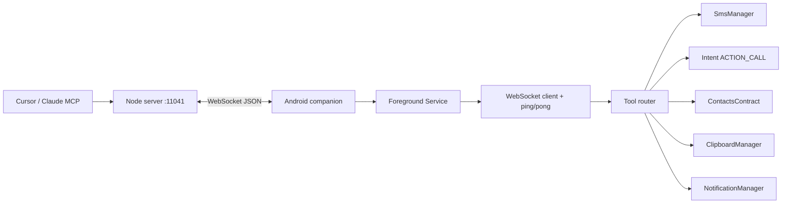

# Flutter and React Native vs Kotlin native

> **Subagent:** `97c66858` — **Complete**  
> **Source:** Read-only web research + PhonePi server contract.

## Verdict

For PhonePi's Android-only WebSocket companion (SMS, calls, contacts, clipboard, notifications, persistent LAN connection), **Kotlin native** is the lowest-risk fit. **Flutter** is a solid second choice with stronger plugin coverage than React Native for telephony. **React Native** works if your team already lives in JS, but SMS/background WebSocket need more native glue and notification maintenance is fragmented ([Notifee archived](https://github.com/invertase/notifee/); use `react-native-notify-kit`).

---

## PhonePi context

The Node server at `server/src/index.ts` defines the contract: the phone is a **WebSocket client** on port **11041**, receives `{ type: "request", requestId, tool, params }`, replies with `{ type: "response", requestId, data }`, and answers pings every 15s.

| Category | Tools |
|---|---|
| Telephony | `send_sms`, `make_call` |
| Contacts | `get_contacts`, `get_contact_by_id`, `add_contact`, `update_contact`, `delete_contact` |
| Clipboard | `copy_to_clipboard` |
| Notifications | `send_notification` (+ persistent FGS notification for background WS) |
| Other | `get_battery_level`, snippets CRUD, `find_phone`, `set_timer`, `share_snippet`, `send_message` |

All three frameworks must solve the same constraint: **a persistent WebSocket needs a foreground service on Android 13+**, or the OS kills the socket within ~20s in background ([Stack Overflow](https://stackoverflow.com/questions/78245019/android-13-14-seem-to-close-websocket-connection-if-i-put-app-in-background)).

---

## Plugin ecosystem (PhonePi-specific)

| Capability | Flutter | React Native | Kotlin native |
|---|---|---|---|
| **SMS send** | Good. [`advanced_sms_log`](https://pub.dev/packages/advanced_sms_log), [`another_telephony`](https://fluttergems.dev/sms/), [`sms_sender_background`](https://fluttergems.dev/sms/) wrap `SmsManager`. Play policy applies. | Weak for silent send. [`expo-sms`](https://docs.expo.dev/versions/latest/sdk/sms/) opens system UI only. Background receive needs niche libs. | **Best.** Direct `SmsManager.sendTextMessage()`. |
| **Phone calls** | Adequate. `tel:` via [`url_launcher`](https://medium.flutterdevs.com/implementing-phone-calls-using-the-flutter-app-e350ea275c92) or `flutter_phone_direct_caller`. Deep control needs [`flutter_tele`](https://pub.dev/packages/flutter_tele). | Adequate for dial-out (`Linking.openURL('tel:…')`). [`react-native-callkeep`](https://github.com/react-native-webrtc/react-native-callkeep) is VoIP-focused, overkill. | **Best.** `ACTION_CALL` / `ACTION_DIAL` intents, no bridge. |
| **Contacts CRUD** | **Strong.** [`flutter_contacts`](https://pub.dev/packages/flutter_contacts) covers read/write, groups, change listeners, bulk ops. | **Strong.** [`react-native-contacts`](https://www.npmjs.com/package/react-native-contacts) (v8.x) covers full CRUD. | **Best.** `ContentResolver` + `ContactsContract`; zero abstraction tax. |
| **Clipboard write** | **Trivial.** Built-in [`Clipboard.setData`](https://api.flutter.dev/flutter/services/Clipboard-class.html). | **Trivial.** `@react-native-clipboard/clipboard`. | **Trivial.** `ClipboardManager`. |
| **Notifications** | Good. [`flutter_local_notifications`](https://pub.dev/packages/flutter_background_service) + [`flutter_background_service`](https://pub.dev/packages/flutter_background_service) for FGS. | Fragmented. [`@notifee/react-native` archived](https://github.com/invertase/notifee/); use [`expo-notifications`](https://github.com/invertase/notifee/issues/1254) (no FGS) or fork [`react-native-notify-kit`](https://github.com/marcocrupi/react-native-notify-kit). | **Best.** `NotificationManager` + `NotificationChannel`. |
| **Background WebSocket** | Dedicated plugin [`background_socket_connect`](https://pub.dev/packages/background_socket_connect) (FGS + reconnect). | No first-party solution. [`react-native-background-actions`](https://javascript.plainenglish.io/keep-the-stomp-socket-alive-in-background-react-native-react-native-background-actions-a5d498473821) wrapping a FGS; JS owns the socket. | **Best.** OkHttp/Ktor WebSocket inside a `Service` with `startForeground()`. |
| **Battery / audio / timers** | `battery_plus`, `audioplayers`, `android_alarm_manager_plus` or platform channels. | `@react-native-community/*` or small native modules. | Direct `BatteryManager`, `MediaPlayer`/`Ringtone`, `AlarmManager`. |

---

## Dev iteration speed

| Factor | Flutter | React Native | Kotlin native |
|---|---|---|---|
| **Hot reload** | Sub-second (~0.4–0.8s), state preserved | Fast Refresh ~1.2–1.8s; occasional full reload | Gradle incremental; Compose preview helps UI only |
| **First build** | ~1.5h setup; Dart learning curve | Faster if team knows JS/React; Metro + native rebuild for native changes | Fastest for Android-only |
| **UI complexity for PhonePi** | Low (connection + settings + permissions) | Low, same | Low; Jetpack Compose concise |
| **Debugging telephony** | Plugin + manifest + permission issues; Dart DevTools | Flipper + Metro; native module mismatches on New Arch | Logcat + breakpoints directly on `SmsManager`, `ContentResolver` |
| **Net verdict** | Fast UI iteration; telephony still needs native manifest work | Fast if JS team; telephony/FGS slows you down | Slower UI loop; fastest path to reliable device APIs |

---

## Platform channel / native bridge complexity

PhonePi is **not** UI-heavy. It is a **device-API gateway** over WebSocket, which shifts the calculus toward native access.

| Deep Android API | Flutter | React Native | Kotlin native |
|---|---|---|---|
| **Bridge model** | `MethodChannel` / `EventChannel`; async serialization + JNI | TurboModules + Codegen; TS spec → C++/Kotlin scaffold | None |
| **When plugins fall short** | Write Kotlin plugin / `MethodChannel` handler; moderate boilerplate | Write TurboModule wrapper; 1–3 week migration tax per unmaintained lib | Write Kotlin directly |
| **FGS + WebSocket** | Plugin abstracts most (`background_socket_connect`) | Custom FGS + HeadlessJS or background-actions; more glue | ~100–200 lines of `Service` + OkHttp |
| **SMS permissions / Play policy** | Plugin docs + manifest; still your responsibility | Same + fewer maintained send libs | Full control; easiest to justify `SEND_SMS` |
| **Risk for PhonePi** | **Low–medium** | **Medium–high** | **Lowest** |

---

## Master comparison

| Criterion | Flutter | React Native | Kotlin native |
|---|---|---|---|
| Fit for WebSocket gateway app | ★★★★ | ★★★ | ★★★★★ |
| SMS ecosystem | ★★★★ | ★★ | ★★★★★ |
| Calls ecosystem | ★★★★ | ★★★★ | ★★★★★ |
| Contacts ecosystem | ★★★★★ | ★★★★★ | ★★★★★ |
| Clipboard | ★★★★★ | ★★★★★ | ★★★★★ |
| Notifications + FGS | ★★★★ | ★★★ (ecosystem churn) | ★★★★★ |
| Background WS reliability | ★★★★ | ★★★ | ★★★★★ |
| Dev iteration speed | ★★★★★ | ★★★★ | ★★★ |
| Native API depth / low risk | ★★★ | ★★ | ★★★★★ |
| Android-only maintenance | ★★★ | ★★★ | ★★★★★ |
| Future iOS companion | ★★★★★ | ★★★★★ | N/A (rewrite) |
| Team JS/TS alignment | ★★ (Dart) | ★★★★★ | ★★ (Kotlin) |

---

## Recommendation

**Kotlin native (Jetpack Compose + Foreground `Service` + OkHttp WebSocket)** is the best match because:

1. The app is a **headless-ish device proxy**, not a rich UI product. Most effort goes to `SmsManager`, `ContactsContract`, FGS, and reconnect logic; Kotlin gives direct access with no bridge tax.
2. The server protocol is simple JSON over WS; no cross-platform UI payoff justifies Flutter/RN overhead.
3. React Native has the **weakest SMS story** for silent programmatic send, and its notification stack is in transition (Notifee archived April 2026).
4. Flutter is the **best cross-platform fallback** if you plan an iOS companion soon: `flutter_contacts` + built-in clipboard + `background_socket_connect` cover ~80% of PhonePi with less custom native code than RN.

**Choose React Native** only if your team is already deep in RN/Expo and accepts writing TurboModules for SMS send + FGS WebSocket, using `react-native-notify-kit` instead of archived Notifee.

See [kotlin-native.md](kotlin-native.md) for the recommended native implementation detail.

---

## Suggested architecture (any framework)

