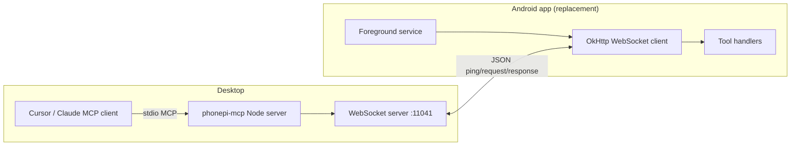

# Kotlin native Android app

> **Subagent:** `fe844504` — **Complete**  
> **Source:** Repo protocol/tool research + Android platform knowledge + read-only web research.

## Recommendation

Build a **thin native Android client**: OkHttp WebSocket + foreground `dataSync` service + kotlinx.serialization + modular tool handlers. Leave the **`phonepi-mcp` Node server untouched**; it already translates MCP ↔ phone JSON. Skip the **MCP Kotlin SDK** unless you add a separate on-device MCP server later.

---

## Architecture (unchanged Node server)

Your existing `phonepi-mcp` server stays the bridge. It does not speak MCP to the phone; it speaks a **custom JSON protocol** over WebSocket.



| Component | Protocol | Direction |
|-----------|----------|-----------|
| Cursor ↔ Node | MCP (stdio) | Desktop only |
| Node ↔ Phone | Custom JSON over WS | Phone **connects outbound** to `ws://<desktop-ip>:11041` |

The Node server listens on `0.0.0.0:11041`, keeps **one** phone socket (new connection replaces old), pings every 15s, and drops the phone after 45s without `pong`. Tool calls time out at 30s.

---

## Wire protocol (from server code)

Implement exactly this on Android; no MCP SDK needed on the phone.

**Server → phone (request)**

```json
{ "type": "request", "requestId": "req-1", "tool": "get_battery_level", "params": {} }
```

**Phone → server (response)**

```json
{ "type": "response", "requestId": "req-1", "data": { "status": "success", ... } }
```

**Keepalive:** server sends `{ "type": "ping" }`; phone must reply `{ "type": "pong" }`.

**Errors:** `{ "data": { "status": "error", "error": "..." } }`

**Active tools** (from `server/src/index.ts`): `get_battery_level`, snippet CRUD/search/share, `send_sms`, `make_call`, `find_phone`, `set_timer`, `copy_to_clipboard`, contacts CRUD, `send_message`, `get_message_response`, `send_notification`. Commented-out tools (`take_photo`, `get_location`, alarms) can be added later without server changes if you match the same tool names and param shapes.

---

## Kotlin + OkHttp WebSocket

**Why OkHttp:** Square's WebSocket API is stable, widely used on Android, and fits a thin JSON RPC client. You do not need Ktor or Scarlet unless you want built-in lifecycle/backoff helpers.

**Core pieces**

1. **`OkHttpClient`** — long read timeout (or none); disable OkHttp-level pings if you rely on PhonePi's app-level `ping`/`pong`.
2. **`WebSocketListener`** — parse JSON on OkHttp's reader thread; dispatch to a coroutine scope (`Dispatchers.Default` + `SupervisorJob`).
3. **Correlation map** — not needed on phone (phone only **responds** to requests; it does not originate correlated requests unless you add phone-initiated calls like `get_server_info` later).
4. **Reconnect** — exponential backoff (1s → 2s → … cap 60s), reset on successful `open`; listen to `ConnectivityManager` for network regain.
5. **Cleartext** — protocol is `ws://` on LAN. Add a [network security config](https://developer.android.com/privacy-and-security/security-config) allowing cleartext to the user-configured host only (not global).

```kotlin
class PhonePiWebSocketListener(
    private val scope: CoroutineScope,
    private val router: ToolRouter,
    private val onPong: () -> Unit,
) : WebSocketListener() {
    override fun onMessage(webSocket: WebSocket, text: String) {
        scope.launch {
            when (val msg = json.decodeFromString<WireMessage>(text)) {
                is Ping -> webSocket.send("""{"type":"pong"}""")
                is Request -> webSocket.send(router.handle(msg))
            }
        }
    }
}
```

Use **kotlinx.serialization** (or Moshi) for `WireMessage` sealed types matching the `type` field.

---

## Foreground service

Background WebSocket without a foreground service gets killed on Android 8+ and is unreliable under Doze.

**Pattern**

- `ConnectionForegroundService` owns the OkHttp client and WebSocket.
- `startForeground()` with a low-priority ongoing notification ("Connected to PhonePi MCP").
- `START_STICKY` so the system restarts after kill; reconnect in `onStartCommand`.
- Optional `LocalBinder` for UI status (connected / host / last error).

**Android 14+ (API 34+) requirements** ([foreground service types](https://developer.android.com/develop/background-work/services/fgs/service-types)):

| Declaration | Suggested value |
|-------------|-----------------|
| `android:foregroundServiceType` | `dataSync` (network sync with desktop) |
| Manifest permission | `FOREGROUND_SERVICE`, `FOREGROUND_SERVICE_DATA_SYNC` |
| `startForeground()` flag | `FOREGROUND_SERVICE_TYPE_DATA_SYNC` |

`connectedDevice` is a fallback if you frame the desktop as an external peer; it often needs extra runtime permissions (Bluetooth/USB) you do not need here.

**Also declare:** `INTERNET`, `ACCESS_NETWORK_STATE`, `WAKE_LOCK` (optional, for reconnect bursts), `POST_NOTIFICATIONS` (API 33+). Start the service from a "Connect" action; stop on explicit disconnect.

---

## Per-feature Android APIs

Map each MCP tool (via WS `tool` name) to a handler module. Return `{ "status": "success", ... }` or `{ "status": "error", "error": "..." }` in `data`.

| Tool | Android API | Permissions / notes |
|------|-------------|---------------------|
| `get_battery_level` | `BatteryManager` / `ACTION_BATTERY_CHANGED` sticky broadcast | None for level |
| Snippets (`add_snippet`, …) | **Room** + optional **DataStore** for prefs | None; local DB |
| `send_sms` | `SmsManager.sendTextMessage` | `SEND_SMS` (runtime); real device required |
| `make_call` | `Intent(ACTION_CALL, tel:…)` or `ACTION_DIAL` | `CALL_PHONE` or none if dial-only |
| `find_phone` | `Ringtone` / `MediaPlayer`, `Vibrator`, full-screen Activity for dismiss | `VIBRATE`; respect DND |
| `set_timer` | `AlarmManager` + `BroadcastReceiver` or in-app coroutine + notification | `SCHEDULE_EXACT_ALARM` on API 31+ if exact |
| `copy_to_clipboard` | `ClipboardManager.setPrimaryClip` | None |
| Contacts CRUD | `ContactsContract` + `ContentResolver` | `READ_CONTACTS`, `WRITE_CONTACTS` |
| `share_snippet` | `Intent.ACTION_SEND` (+ package for WhatsApp) | None |
| `send_message` / `get_message_response` | Room table + Notification with action buttons | `POST_NOTIFICATIONS`; store pending replies |
| `send_notification` | `NotificationManagerCompat` | Channel + priority mapping from `priority` param |

**Permission UX:** request permissions when the user enables a feature group in settings, not all at install. **SMS/calls on emulator:** often fail or behave oddly; plan for physical device testing.

---

## Hot reload, testing, adb

### Android Studio iteration ([Apply Changes](https://developer.android.com/studio/run))

| Change type | Fast path |
|-------------|-----------|
| Method body in tool handler | Apply Code Changes |
| UI Compose tweaks | Live Edit (experimental) |
| New tool class, manifest, service type, permissions | Full Run |
| WebSocket/service lifecycle in `onCreate` | Restart Activity or full Run |

Apply Changes needs debug build + API 26+. Manifest or new fields/methods force full reinstall.

### adb workflows

- **`adb logcat -s PhonePi:*`** — filter WS connect/disconnect and tool dispatch tags.
- **`adb reverse tcp:11041 tcp:11041`** — USB: phone connects to `127.0.0.1:11041` while Node runs on the PC. Avoids Wi‑Fi during dev.
- **`adb shell am start-foreground-service`** — verify FGS behavior without tapping UI.
- **Instrumented tests** — mock `ToolRouter` with fake JSON requests; unit-test handlers without a live socket.

### Integration test with unchanged server

1. Start Node as today: `npx phonepi-mcp start` (stdio + WS on 11041).
2. Point Android app at desktop IP (or `127.0.0.1` with `adb reverse`).
3. Confirm `ping`/`pong` in logcat; trigger a tool from Cursor ("send test notification").
4. No server code changes unless you add new tools.

**Tailscale:** phone and desktop on the same tailnet; connect to `100.x.x.x:11041`. See [tailscale.md](../04-security/tailscale.md).

---

## Official MCP Kotlin SDK vs custom OkHttp

| | **MCP Kotlin SDK** (`io.modelcontextprotocol:kotlin-sdk`) | **Custom OkHttp + JSON** |
|--|---------------------------------------------------------------------|---------------------------|
| **Purpose** | Full MCP client/server: initialize, capabilities, `tools/list`, `tools/call`, transports for MCP frames | PhonePi's **non-MCP** `{type, requestId, tool, params}` envelope |
| **Phone role** | Would wrongly position phone as MCP peer to Cursor | Correct: phone is a **device executor** behind Node bridge |
| **Dependencies** | Ktor, MCP core, coroutines, multiplatform stack | OkHttp, kotlinx.serialization, coroutines |
| **Binary size** | Larger | Smaller |
| **Maintenance** | Tracks MCP spec churn you do not use on-device | Tracks only your stable wire format in `server/src/index.ts` |

**Verdict:** MCP Kotlin SDK is **overkill and mismatched**. Its `WebSocketClientTransport` speaks MCP JSON-RPC sessions, not PhonePi's tool forwarding. Community wrappers ([android-mcp-sdk](https://github.com/AnswerZhao/android-mcp-sdk), [Mobile-MCP](https://github.com/Mobile-MCP/Mobile-MCP)) target **on-device MCP servers** (Binder/AIDL, LLM-on-phone) — a different product. Use the MCP SDK only if you later expose MCP **from** the phone to other local apps.

---

## Pros and cons

### Pros

- Full control over permissions, UI, and open-source audit (aligns with the security story).
- No React Native/Expo bridge; direct access to `SmsManager`, `ContactsContract`, alarms.
- Same Node MCP config in Cursor; zero desktop migration.
- Foreground service + OkHttp is a well-documented, boring stack.
- Feature flags: ship minimal tools first, expand incrementally.

### Cons

- You own reconnect, battery optimization, OEM kill policies (Xiaomi, Samsung).
- Play Store scrutiny for SMS/call permissions; may need strong justification or sideload-only distribution.
- Cleartext WS on LAN; Tailscale helps but is not TLS by default on `ws://`.
- Single-connection model: no multi-phone without server changes.
- Parity with official PhonePi app is manual (every tool + edge case).

---

## Recommended project structure

Gradle **multi-module** keeps the WS layer stable while features grow:

```
phonepi-android/
├── app/                          # ApplicationId, manifest, DI graph, nav
│   └── PhonePiApplication.kt
├── core/
│   ├── protocol/                 # WireMessage, Request, Response, Ping/Pong
│   ├── network/                  # OkHttp factory, NetworkMonitor
│   └── common/                   # Result types, dispatchers
├── connection/
│   ├── websocket/                # PhonePiWebSocketClient, reconnect policy
│   └── service/                  # ConnectionForegroundService + notification
├── domain/
│   └── router/                   # ToolRouter: tool name → handler
├── feature/
│   ├── battery/
│   ├── snippets/                 # Room DAO + entities
│   ├── contacts/
│   ├── sms/
│   ├── telephony/                # make_call
│   ├── clipboard/
│   ├── notifications/
│   ├── messaging/                # send_message / get_message_response
│   ├── findphone/
│   └── timer/
└── ui/
    ├── setup/                    # host, port, connect/disconnect
    ├── status/                   # connection state, granted permissions
    └── findphone/                # dismiss overlay Activity
```

**Patterns**

- **Hilt** for injecting handlers into `ToolRouter`.
- **Room** for snippets and interactive messages.
- **Single `ToolHandler` interface:** `suspend fun invoke(params: JsonObject): JsonObject`.
- **Register map:** `Map<String, ToolHandler>` built at startup from enabled modules.
- **Settings:** DataStore for `host`, `port` (default `11041`), `enabledTools`.

**Suggested build order**

1. `protocol` + `websocket` + `service` + setup UI → connect, ping/pong, `get_battery_level`.
2. `send_notification`, `copy_to_clipboard` (easy wins for Cursor testing).
3. Snippets (Room).
4. Contacts, SMS, calls (permissions-heavy).
5. `find_phone`, `send_message` / `get_message_response`, `set_timer`.
