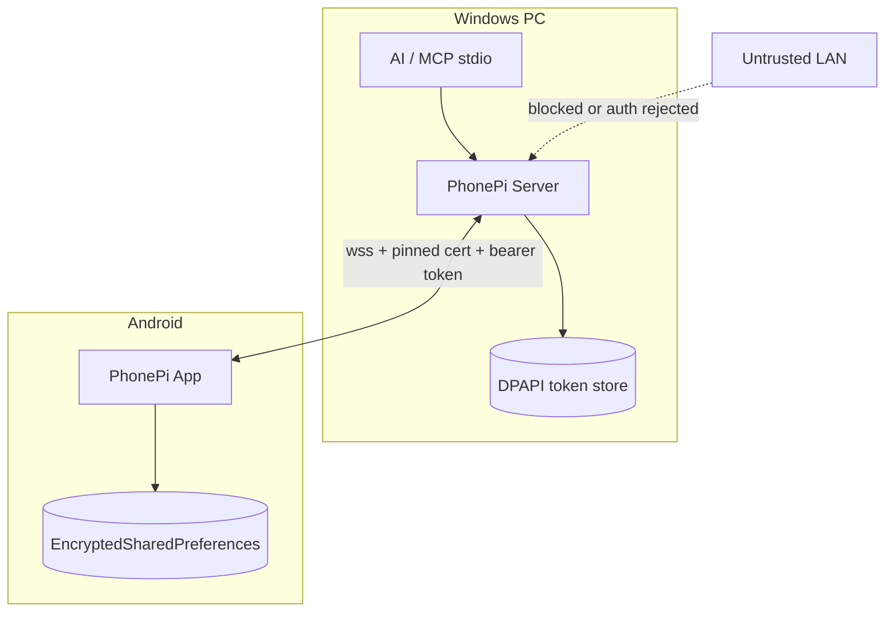

# Local security (secure-by-default, no cloud)

> **Subagent:** `0c717039` — **Complete**  
> **Source:** `server/src/index.ts` analysis + read-only web research

## Executive summary

PhonePi treats the LAN as a trusted zone. The MCP server listens on **all interfaces** at **port 11041** with **no TLS, no pairing, and no session auth**. Any device on the same network can connect, displace the real phone, and drive high-impact tools (SMS, calls, contacts, clipboard).

A secure-by-default local design keeps everything offline but adds **opt-in LAN exposure**, **WSS + cert pinning**, **human-in-the-loop pairing**, **short-lived session tokens**, and **OS-level firewall defaults on Windows**.

---

## Current state

### Network binding

- Binds to `0.0.0.0` — reachable from Wi‑Fi, Ethernet, VPN (Tailscale), guest networks.
- `verifyClient` only logs; always returns `true`.
- Plain `ws://` (no TLS).

### Connection model

- **Single slot:** latest WebSocket client becomes "the phone."
- No client identity, pairing state, or role check.
- LAN peer can **kick the real phone** or **impersonate it**.

### Architecture gap

```
[AI app] --stdio--> [PhonePi MCP server] <--ws:11041--> [Android app]
                           ^
                           |
              Any LAN client can connect here
```

---

## Threat model

| Actor | Impact |
|-------|--------|
| Same-LAN device | Connection hijack, DoS, probe `get_server_info` |
| Malicious website (CSWSH-style) | May reach localhost/LAN listeners without auth |
| Shared Wi‑Fi passive attacker | Read SMS, contacts, clipboard on plain `ws://` |
| Rogue MCP on same PC | Full tool access (expected for local AI) |

### Unauthenticated LAN attacker can

1. Connect and become `phoneConnection`.
2. Call local handlers (`ping`, `get_server_info`).
3. DoS by repeatedly reconnecting.
4. Passively sniff JSON on the wire.

---

## LAN exposure: `0.0.0.0` vs `127.0.0.1`

| Bind address | Phone on same Wi‑Fi | Other LAN hosts |
|--------------|---------------------|-----------------|
| `127.0.0.1` | No (unless tunnel) | No |
| `0.0.0.0` | Yes | **Yes** |

**Recommendation:** default `127.0.0.1`; require explicit `--host 0.0.0.0` or `--lan` with startup warning. For LAN phone use, prefer **Tailscale IP binding** over full `0.0.0.0`.

---

## Android permission model

| PhonePi tool | Android permission(s) |
|--------------|----------------------|
| `send_sms` | `SEND_SMS` |
| `make_call` | `CALL_PHONE` |
| Contacts tools | `READ_CONTACTS`, `WRITE_CONTACTS` |
| `get_battery_level` | None (via `BatteryManager`) |
| `copy_to_clipboard` | None; focus required API 29+ |
| `find_phone`, notifications | `POST_NOTIFICATIONS`, FGS |
| `take_photo` (commented) | `CAMERA` |

### Secure-by-default on Android

1. **Permission tiers:** Basic / Messaging / Contacts / Telephony.
2. **Runtime + rationale** before system dialog.
3. **Play policy:** SMS/call may need sideload for DIY app.
4. **Network Security Config:** block cleartext in release; pin local CA.

---

## TLS, WSS, and certificate pinning

1. Generate **local CA** + **server cert** (SANs: `localhost`, `127.0.0.1`, LAN IP, Tailscale hostname).
2. Ship **CA public cert** to Android via pairing QR.
3. Android `network_security_config.xml`: trust only `@raw/phonepi_ca`; disable cleartext in release.
4. **Pin server SPKI** in `pin-set`.

Pinning is warranted: high-privilege local control channel.

---

## Pairing and token options (no cloud)

### Option A: QR pairing (recommended)

1. Server enters **pairing mode**; QR with `{ host, port, pairing_nonce, server_pubkey_fingerprint }`.
2. Phone scans; shows **6-digit confirm code**.
3. User confirms on **both** sides.
4. **PAKE** (e.g. SPAKE2+) over initial WSS to derive session key.
5. Server issues `{ device_id, refresh_token }` stored in EncryptedSharedPreferences / DPAPI.
6. Later messages: `{ type: "auth", device_id, access_token, role: "phone" }` as first frame.

### Option B: Manual one-time code

User types PC IP + 8-char code from server terminal.

### Option C: Pre-shared token (power users)

`phonepi-mcp start --pairing-token <random>` — simple but no PAKE.

### Session model

| Token | Lifetime |
|-------|----------|
| Pairing nonce | 5 min, single use |
| Access token | 15–60 min |
| Refresh token | Until revoked |

### Role separation

| Role | Can do |
|------|--------|
| `phone` | Execute tools, send responses |
| MCP stdio | Tool calls via authenticated phone bridge |

Reject connections without valid `auth` within 5 seconds.

---

## Windows firewall recommendations

| Profile | Port 11041 inbound |
|---------|-------------------|
| **Public** | Block |
| **Private** | Block by default; allow after pairing OR `--open-firewall` |
| **Domain** | Admin choice |

**Tighter:** allow only phone IP or Tailscale `100.64.0.0/10`.

Always set `-Profile` explicitly on `New-NetFirewallRule`.

---

## Proposed secure-by-default architecture



### Server defaults (vNext)

| Setting | Default | Override |
|---------|---------|----------|
| Host | `127.0.0.1` | `--lan`, `--host`, `--tailscale` |
| TLS | On (WSS) | `--insecure-ws` dev only |
| Pairing | Required | `--dev-skip-auth` |
| Port | `11041` | `--port` |

### Additional hardening

1. Rate limit connection attempts (lockout after 10 failures).
2. Constant-time token comparison.
3. Local audit log: connect, auth, tool name (no message bodies).
4. Tool policy file: disable `send_sms` / `make_call` unless enabled.
5. Phone confirmation for destructive actions (first SMS per session).

### Migration path

| Phase | Change |
|-------|--------|
| 1 | Pairing + bearer token on existing `ws://`; default `127.0.0.1` |
| 2 | WSS + Android network config + pinning |
| 3 | Windows firewall docs + optional installer |
| 4 | Tool tiers, phone confirmations, audit log |

---

## Priority matrix

| Priority | Item | Risk reduction |
|----------|------|----------------|
| P0 | Pairing + session tokens | Stops casual LAN takeover |
| P0 | Default `127.0.0.1`, opt-in LAN | Shrinks exposure |
| P1 | WSS + cert pinning | Stops sniffing/MITM |
| P1 | Windows firewall guidance | OS-layer defense |
| P2 | IP allowlist / Tailscale-only | Limits connectors |
| P2 | Android permission tiers | Limits on-device blast radius |
| P3 | Per-tool phone confirmation | Stops automated abuse |
