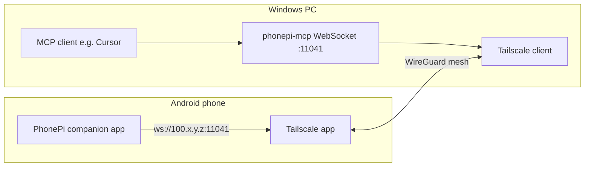

# Tailscale integration

> **Subagent:** `efd44604` — **Complete**  
> **Source:** Tailscale docs + `server/src/index.ts` (port 11041, `0.0.0.0`, no WS auth)

## Architecture



| Layer | Role |
|-------|------|
| **Tailscale** | Private mesh VPN; **100.64.0.0/10** IPs |
| **Windows** | Runs `phonepi-mcp`; listens on all interfaces including Tailscale adapter |
| **Android** | Tailscale + PhonePi app; connects to PC **Tailscale IP or MagicDNS** + port **11041** |
| **MCP client** | stdio to local server; does not need Tailscale |

**Traffic:** Android opens `ws://<pc-tailscale-ip>:11041` → WireGuard tunnel → Windows → WebSocket server.

Encryption is at VPN layer (WireGuard); PhonePi uses plain `ws://`, not `wss://`.

**Subnet routing:** Not required when both endpoints run Tailscale. Use only for non-Tailscale LAN devices.

---

## Phased setup

### Phase A — Local LAN baseline

1. `phonepi-mcp start` on Windows (port **11041**).
2. PhonePi app: **LAN IP** + **11041**.
3. Confirm tools work; fix Windows Firewall for private profile if needed.

**Success:** Phone ↔ PC on home Wi‑Fi.

### Phase B — Tailscale install

**Admin console:**

1. Enable **MagicDNS**.
2. Rename machines (`gaming-pc`, `pixel-phone`).

**Windows:** Install Tailscale; sign in; note **100.x** address.

**Android:** Install Tailscale; sign in; keep VPN active. Disable exit node during PhonePi testing if routing issues occur.

**Success:** Both devices show Connected with **100.x** addresses.

### Phase C — PhonePi over Tailscale (same network)

1. Change app host from LAN IP to **100.x** or MagicDNS name (`gaming-pc`).
2. Port stays **11041**.
3. Re-test commands.

**Success:** Works via tailnet addressing on home Wi‑Fi.

### Phase D — Remote access

1. Phone on cellular; Tailscale active on both devices.
2. Connect using **Tailscale IP or MagicDNS** (not LAN IP).
3. Expect higher latency if connection is **relayed** (DERP).

**Success:** Remote control without router port forwarding.

---

## MagicDNS

| Setting | Recommendation |
|---------|----------------|
| Enable MagicDNS | Yes — use `gaming-pc` instead of memorizing `100.x` |
| Override DNS | Leave off unless needed |
| HTTPS certs | Not needed for plain `ws://11041` |

| Option | Example |
|--------|---------|
| Tailscale IP | `100.101.102.103` |
| MagicDNS short | `gaming-pc` |
| MagicDNS FQDN | `gaming-pc.your-tailnet.ts.net` |

---

## Exposing only to tailnet

| Method | PhonePi stance |
|--------|----------------|
| Tailscale mesh (100.x) | **Primary** — not internet-routable |
| No router port forward | **Required** |
| `tailscale funnel` | **Do not use** — public internet |
| ACL / grants | Restrict who reaches PC:11041 |
| Windows Firewall | Scope inbound 11041 to Tailscale adapter |

**Note:** Server binds `0.0.0.0` and accepts any WebSocket client. Tailscale limits reachability to tailnet members, but **any tailnet device** on port 11041 can connect. ACLs are the real access gate.

---

## ACL / grants policy outline

Default tailnet = allow-all between members. When tailnet grows, tighten:

**Goals:**

1. Admin: full access.
2. Phone → PC: **only TCP 11041**.
3. Block phone → RDP/SMB/SSH unless needed.
4. Tag PC as `tag:phonepi-server`.

**Outline:**

```
tagOwners: tag:phonepi-server → autogroup:admin
grants:
  - src: autogroup:admin → dst: *:*
  - src: tag:phone or autogroup:member → dst: tag:phonepi-server:11041
```

When adding custom ACLs, include **admin allow-all** first — implicit allow-all disappears.

---

## Security best practices (personal tailnet)

| Area | Practice |
|------|----------|
| Identity | IdP with MFA |
| Device approval | Manual approve each new device |
| Auth keys | Avoid long-lived reusable keys; never commit `tskey-*` |
| No Funnel | Do not grant `funnel` on PhonePi hosts |
| Least privilege ACLs | Limit port 11041 |
| Audit | Monthly review Machines list |
| Updates | Keep Tailscale current, especially Android |
| Exit nodes | Disable during PhonePi testing unless understood |

**PhonePi-specific:** WebSocket has no app-level auth. Treat tailnet membership + ACL port restriction as security boundary. Combine with [local-security.md](local-security.md) pairing for defense in depth.

---

## Troubleshooting decision tree

```
PhonePi won't connect
├── Tailscale disconnected?
├── Wrong host (still 192.168.x.x remotely)?
│   └── Use 100.x or MagicDNS
├── Windows Firewall blocking 11041?
├── ACL blocking phone → PC:11041?
├── phonepi-mcp not running?
├── Relayed connection slow?
└── Exit node on Android interfering?
```

---

## Implementation doc TOC (for later)

1. Overview — what Tailscale solves for PhonePi
2. Requirements — accounts, apps, ports, firewall
3. Quick start — Phases A–D
4. Windows setup
5. Android setup
6. MagicDNS
7. Remote access expectations
8. Security hardening
9. Optional subnet routing
10. ACL examples
11. Troubleshooting
12. FAQ (`ws://` vs `wss://`, port forwarding, family devices)

---

## PhonePi code facts

From `server/src/index.ts`:

- Default port: **11041**
- Bind: **`0.0.0.0`**
- Protocol: **`ws://`**
- Auth: **none**

Future: bind to Tailscale IP only, token auth, or `tailscale serve` wrapper.
