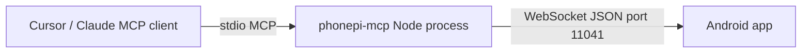

# Official docs vs codebase

> **Subagent:** `52d6999f` — **Complete**  
> **Sources:** [phonepimcp.com](https://www.phonepimcp.com/), [priyankark/phonepi-mcp](https://github.com/priyankark/phonepi-mcp), the Play Store listing, GitHub issues/discussions, and the local tree at `F:\Codeing Project\phonepi-mcp`.

## Executive summary

PhonePi MCP is a **split product**:

| Component | Status | Cost |
|-----------|--------|------|
| MCP server (`phonepi-mcp` npm) | MIT, open on GitHub | Free |
| PhonePi CLI (`phonepi-cli`) | In same repo | Free (needs Anthropic API key) |
| Android companion app (`com.priykum.PhonePiMCP`) | **Not in GitHub** | **$3.49** on Play Store |

Official marketing says "open source" and "MIT-licensed," which is true for the **desktop server only**. The Android app is required for real phone control and is **closed-source and paid**. No leaked or official MCP Android source was found.

The local repo matches the upstream server architecture; it is forked from `Belhun/phonepi-mcp`, not directly from `priyankark/phonepi-mcp`.

---

## What official sources say

### Website ([phonepimcp.com](https://www.phonepimcp.com/))

- **23+ actions**: SMS, calls, contacts, snippets, clipboard, notifications, battery, timers, etc.
- **Setup:** add MCP config with `npx phonepi-mcp start`; install Play Store app; connect phone to PC IP + port **11041**.
- **Privacy:** 100% local, no third-party servers, no cloud storage.
- **Remote access:** Tailscale recommended.
- **Troubleshooting:** IP discovery, port 11041 conflicts, `npx phonepi-mcp stop`.
- **iOS:** in development.
- **PhonePi CLI:** AI terminal interface (separate from core MCP flow).

### GitHub ([priyankark/phonepi-mcp](https://github.com/priyankark/phonepi-mcp))

- Created **Mar 28, 2025**; last push **Apr 15, 2025** (~34 stars).
- Repo contents: `README.md`, `LICENSE`, `server/`, `phonepi-cli/`, `.github/` — **no Android folder**.
- MIT license; security notes match the website (local network, Tailscale, permission control).
- Broken issue links in README (`yourusername/phone-mcp`).

### Play Store ([com.priykum.PhonePiMCP](https://play.google.com/store/apps/details?id=com.priykum.PhonePiMCP))

| Field | Value |
|-------|--------|
| Price | **$3.49** (paid, not free/IAP) |
| Developer | Priyankar Kumar (Udupi, Karnataka) |
| Downloads | 10+ |
| Last updated | Aug 27, 2025 |
| Target SDK | 35 |
| Category | Productivity |

**Data safety (developer-declared):** no data collected or shared with third parties; **data isn't encrypted**; **data can't be deleted**.

**Note in listing:** requires companion software on PC; points to phonepimcp.com. Developer also publishes other paid apps (AirCodum Agentum ~$7, PhonePi Sensor Stream Pro ~$6, etc.).

### Legal pages

- **[Terms](https://www.phonepimcp.com/terms-of-service)** (Dec 10, 2025): no data collection; SMS/call requests **open the phone's default messaging/dialer apps** rather than executing silently; "open source" refers to GitHub server code.
- **[Privacy](https://www.phonepimcp.com/privacy-policy)** (Dec 10, 2025): bridge only; AI clients have their own privacy policies.

### Community issues

| Issue | Status | Topic |
|-------|--------|--------|
| [#4](https://github.com/priyankark/phonepi-mcp/issues/4) Instant crash enabling Background Service | **Open** (Mar 14, 2026) | Android app stability |
| [#2](https://github.com/priyankark/phonepi-mcp/issues/2) "Someone rooting / messages passed by others" | Closed as spam | Maintainer: no 3p servers; Google limits permissions; use secure network |

**Discussions:** only the default welcome thread; no protocol spec or connection-debug threads. Third-party directories (MCP.Directory, MCPgee) repeat README content and count **22 tools**; none document the WebSocket wire format.

---

## What the codebase reveals

The local tree mirrors upstream: `server/` (npm package `phonepi-mcp` v**1.0.29**) and `phonepi-cli/` (v**1.0.3**). No Android code.

### Architecture (not spelled out in official docs)



1. **MCP transport:** stdio when launched via `phonepi-mcp start` (`server-manager.ts` spawns `index.js --stdio`).
2. **Phone link:** WebSocket server on **`0.0.0.0:11041`** in the same Node process.
3. **Custom JSON protocol** (undocumented publicly):

```json
{ "type": "request", "requestId": "req-N", "tool": "<tool_name>", "params": {} }
{ "type": "response", "requestId": "req-N", "data": {} }
{ "type": "ping" } / { "type": "pong" }
```

4. **Heartbeat:** ping every 15s; disconnect after 45s without pong.
5. **Request timeout:** 30 seconds per tool call.
6. **Single phone:** new connection replaces the previous one.

### Security gaps the code exposes (docs understate these)

- **`verifyClient` accepts all connections** — no token, pairing, or TLS.
- **Binds all interfaces** (`host: "0.0.0.0"`) — reachable from LAN/VPN peers who know the port and message shape.
- Docs say "secure network"; code does not enforce it.

### MCP tools: docs say "23+", code exposes **22 active**

Active tools: `get_battery_level`, 7 snippet tools, `send_sms`, `make_call`, `find_phone`, `set_timer`, `copy_to_clipboard`, 5 contact tools, `share_snippet`, `send_message`, `get_message_response`, `send_notification`.

**Commented out** (not exposed to MCP clients): `take_photo`, `get_location`, `set_alarm`, `cancel_alarm_or_timer`, `stop_alarm`. The handler for `take_photo` responses still exists, suggesting planned or app-side support not yet shipped in the tool list. See [disabled-tools-roadmap.md](../02-tools/disabled-tools-roadmap.md).

### Terms vs tool names

Terms say SMS/calls open default apps. The server still exposes `send_sms` and `make_call`; actual behavior is implemented in the **closed Android app**, not verifiable from this repo.

### phonepi-cli

- Wraps Anthropic Claude (`claude-3-7-sonnet-20250219`) around the same MCP server.
- Spawns `npx phonepi-mcp start` — adds a **cloud AI dependency** on top of the "local only" story.
- README clone URL still says `yourusername/phonepi-cli`.

---

## Android app source: does it exist?

| Source | Package | Relevant to MCP? |
|--------|---------|------------------|
| [priyankark/phonepi-mcp](https://github.com/priyankark/phonepi-mcp) | — | Server + CLI only |
| [priyankark/PhonePiAndroidApp](https://github.com/priyankark/PhonePiAndroidApp) | `com.phonepi` | **No** — 2017 legacy app, GPL-3.0, unrelated package ID |
| Play Store APK / mirrors | `com.priykum.PhonePiMCP` | Closed binary; **no official source repo** |
| "Leaked" MCP app source | — | **Nothing found** in public search |

The MCP companion app is **proprietary**. Reverse-engineering an APK would be the only way to audit app-side behavior; that was outside read-only web research.

---

## Paid app concerns

1. **Asymmetric openness:** GitHub/README/site emphasize "MIT open source" while the **mandatory** Android client costs **$3.49** and is not source-available.
2. **No price on official site:** phonepimcp.com links to Play Store without stating the fee upfront.
3. **Low adoption signal:** 10+ downloads suggests limited community validation.
4. **Stale upstream:** GitHub last updated Apr 2025; Play Store updated Aug 2025 — server and app may have diverged.
5. **Trust model:** you grant broad phone permissions to a closed app that talks to an unauthenticated LAN WebSocket.
6. **Developer portfolio:** same publisher sells multiple paid "remote control" apps; business model is paid mobile clients around free/open servers.

### DIY implications

- Building an open Android client avoids the Play Store fee but assumes maintenance burden.
- Sideload/APK distribution likely needed for full SMS automation.
- You must implement security (pairing, WSS) yourself — not provided by the official stack today.

---

## Discrepancy table

| Topic | Official docs | Code / store reality |
|-------|---------------|----------------------|
| "Fully open source" | Yes (MIT) | Server/CLI only; Android closed |
| Tool count | 23+ | 22 registered; 5 commented out |
| Protocol | "MCP" (vague) | MCP stdio + **undocumented** WebSocket JSON bridge |
| Security | Local, no 3p servers | No WS auth; listens on all interfaces |
| SMS/calls | Terms: opens default apps | Tools named as direct actions |
| Camera/location | Some articles mention them | Commented out in server |
| iOS | In development | No code in repo |
| Free to use | Implied by OSS messaging | **$3.49** required for Android app |
| Repo activity | "Actively monitored" | 2 open issues; minimal discussions |

---

## Local repo note

- **Remote:** `https://github.com/Belhun/phonepi-mcp.git` (fork, not `priyankark/phonepi-mcp`).
- **Structure** matches upstream: `server/`, `phonepi-cli/`, root README.
- Uncommitted changes: only `package-lock.json` files in both packages.

---

## Bottom line

PhonePi MCP is a workable **desktop MCP server + proprietary paid Android client** design. Official docs accurately describe setup flow, port **11041**, and local-network intent, but overstate "open source" by omitting the paid closed app. The codebase is the authoritative reference for the **server-side protocol and tool surface**; the Android implementation, permission model, and whether SMS/calls truly defer to system UI are **not auditable** without the Play Store binary or a future source release.
