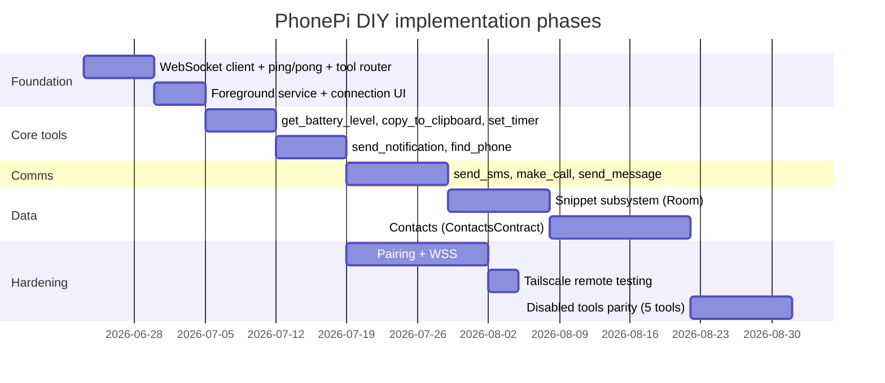

# PhonePi DIY research index

Consolidated findings from 15 background research subagents (June 2026). Source transcripts live under `.cursor/projects/.../agent-transcripts/f6d55a43-.../subagents/`.

## Executive summary

PhonePi is a **local MCP bridge**: Cursor (stdio MCP) ↔ Node server ↔ WebSocket (port **11041**) ↔ Android companion app. The server repo is open source; the official Android app is **paid and closed source**. A DIY replacement should be a **Kotlin native WebSocket client** that implements the JSON protocol and tool handlers without changing the existing Node MCP server.

### Recommended path

| Decision | Recommendation |
|----------|----------------|
| **Platform** | Kotlin + Android SDK (not Flutter/RN, not MCP Kotlin SDK) |
| **Architecture** | Android as pure WebSocket client to existing `phonepi-mcp` server |
| **Networking** | LAN for dev; **Tailscale** for remote; add **WSS + pairing tokens** before wide LAN use |
| **Build order** | Protocol + FGS → device tools → comms → snippets/contacts → disabled-tool parity |

### Security priorities (P0)

1. **Pairing + session tokens** — current protocol has zero auth; any LAN peer can hijack the single phone slot.
2. **Default bind `127.0.0.1`** — opt-in `--lan` instead of `0.0.0.0`.
3. **WSS + certificate pinning** on Android for high-privilege tools (SMS, calls, contacts).
4. **Windows firewall** scoped to Private profile / phone IP / Tailscale subnet.
5. **Permission tiers** on Android — request dangerous permissions only for enabled tool groups.

### Phased build plan

---

## Document map

| Path | Topic | Subagent | Status |
|------|-------|----------|--------|
| [01-protocol/websocket-spec.md](01-protocol/websocket-spec.md) | WebSocket JSON protocol | `f772daec` | Complete |
| [01-protocol/mcp-forwarding-flow.md](01-protocol/mcp-forwarding-flow.md) | MCP ↔ phone request flow | `4e489a23` | Complete |
| [02-tools/device-tools.md](02-tools/device-tools.md) | Battery, find_phone, timer, clipboard | `b1623973`, `6c0325c7` | Complete |
| [02-tools/comms-tools.md](02-tools/comms-tools.md) | SMS, calls, notifications, messages | `5bdaf550`, `ba8b2cc0` | Complete |
| [02-tools/snippets-tools.md](02-tools/snippets-tools.md) | Snippet CRUD + share | `2131b5b2` | Complete |
| [02-tools/contacts-tools.md](02-tools/contacts-tools.md) | Contact CRUD | `0165d960` | Complete |
| [02-tools/disabled-tools-roadmap.md](02-tools/disabled-tools-roadmap.md) | Commented tools + parity | `ca050556` | Complete |
| [03-platform-options/kotlin-native.md](03-platform-options/kotlin-native.md) | Kotlin/Android approach | `fe844504` | Complete |
| [03-platform-options/flutter-react-native.md](03-platform-options/flutter-react-native.md) | Cross-platform comparison | `97c66858` | Complete |
| [03-platform-options/alternative-architectures.md](03-platform-options/alternative-architectures.md) | WS client vs on-device MCP vs Termux | `67f7b16a` | Complete |
| [04-security/local-security.md](04-security/local-security.md) | LAN exposure, pairing, WSS | `0c717039` | Complete |
| [04-security/tailscale.md](04-security/tailscale.md) | Tailnet remote access | `efd44604` | Complete |
| [05-external-research/official-docs-vs-code.md](05-external-research/official-docs-vs-code.md) | phonepimcp.com vs repo | `52d6999f` | Complete |

---

## Key numbers

| Parameter | Value |
|-----------|-------|
| Default WebSocket port | `11041` |
| Server bind | `0.0.0.0` (all interfaces) |
| Ping interval | 15 seconds |
| Keepalive timeout | 45 seconds (no `pong`) |
| Tool request timeout | 30 seconds |
| Active MCP tools | 22 |
| Commented/hidden tools | 5 |
| Full parity target | 27 tools |

---

## Subagent status

All 15 research subagents completed. Every doc above reflects the full final transcript content; none remain pending.

### Notable findings from the final batch

- **Paid closed app:** the Android companion (`com.priykum.PhonePiMCP`) is a **$3.49** Play Store app with no public source. The "open source" claim covers the server only. DIY replacement needs you to build the Android client.
- **SMS/Play policy:** `SEND_SMS` is restricted to default-handler apps on Play; expect sideload distribution for a DIY client.
- **Kotlin confirmed:** OkHttp WebSocket + `dataSync` foreground service beats Flutter/RN for this device-gateway app; the MCP Kotlin SDK is the wrong abstraction for a phone-side WS client.
- **Architecture 1 wins:** Android-as-WebSocket-client reuses the whole Node server; add bearer-token auth (premex-ab pattern) before LAN-wide use.
